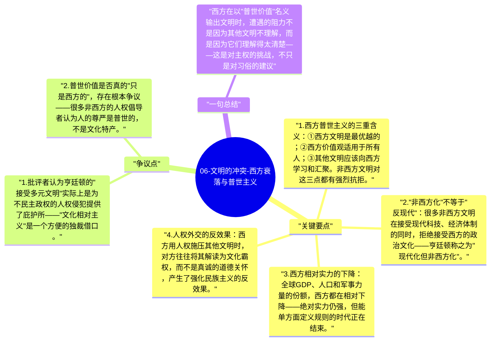

# 06-文明的冲突-西方衰落与普世主义

亨廷顿的一个核心警告是：西方文明在将自身价值定义为"普世价值"并试图推广时，制造了最大的文明摩擦；而西方自身的实力相对衰落，使这种普世主义显得越来越像是强权话语。

## 关键要点

1. **西方普世主义的三重含义**：① 西方文明是最优越的；② 西方价值观适用于所有人；③ 其他文明应该向西方学习和汇聚。非西方文明对这三点都有强烈抗拒。
2. **"非西方化"不等于"反现代"**：很多非西方文明在接受现代科技、经济体制的同时，拒绝接受西方的政治文化——亨廷顿称之为"现代化但非西方化"。
3. **西方相对实力的下降**：全球GDP、人口和军事力量的份额，西方都在相对下降——绝对实力仍强，但能单方面定义规则的时代正在结束。
4. **人权外交的反效果**：西方用人权施压其他文明时，对方往往将其解读为文化霸权，而不是真诚的道德关怀，产生了强化民族主义的反效果。
5. **亨廷顿的政策建议**：西方应该接受多元文明并存的现实，放弃普世主义，专注于强化西方文明自身的凝聚力——这是一种保守的文明防御策略。

## 争议点

1. 批评者认为亨廷顿的"接受多元文明"实际上是为不民主政权的人权侵犯提供了庇护所——"文化相对主义"是一个方便的独裁借口。
2. 普世价值是否真的"只是西方的"，存在根本争议——很多非西方的人权倡导者认为人的尊严是普世的，不是文化特产。

## 一句总结

西方在以"普世价值"名义输出文明时，遭遇的阻力不是因为其他文明不理解，而是因为它们理解得太清楚——这是对主权的挑战，不只是对习俗的建议。

---

## Mermaid 思维导图

### 图1

