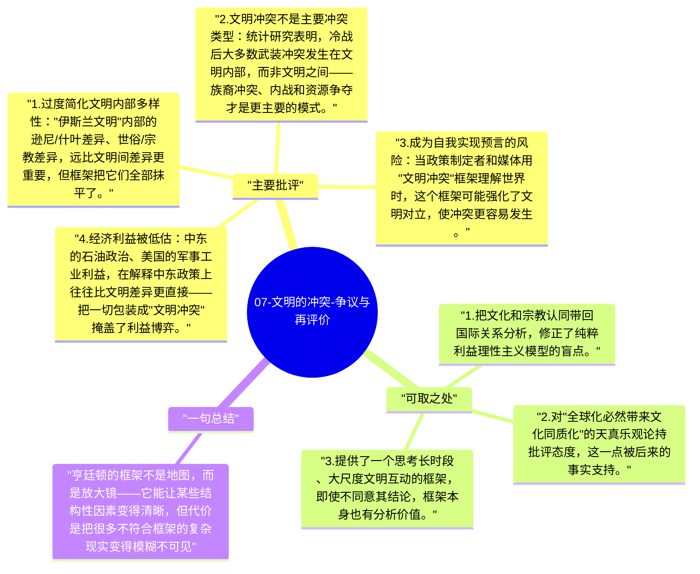

# 07-文明的冲突-争议与再评价

《文明的冲突》出版于1996年，9/11后再度引发广泛讨论——有人认为它预测了恐怖主义的背景；也有人认为这本书本身加剧了文明对立的思维方式。对这本书的批判，和对它的理解同样重要。

## 主要批评

1. **过度简化文明内部多样性**："伊斯兰文明"内部的逊尼/什叶差异、世俗/宗教差异，远比文明间差异更重要，但框架把它们全部抹平了。
2. **文明冲突不是主要冲突类型**：统计研究表明，冷战后大多数武装冲突发生在文明内部，而非文明之间——族裔冲突、内战和资源争夺才是更主要的模式。
3. **成为自我实现预言的风险**：当政策制定者和媒体用"文明冲突"框架理解世界时，这个框架可能强化了文明对立，使冲突更容易发生。
4. **经济利益被低估**：中东的石油政治、美国的军事工业利益，在解释中东政策上往往比文明差异更直接——把一切包装成"文明冲突"掩盖了利益博弈。
5. **规范性偏见**：亨廷顿站在西方文明立场写作，他的"西方应该收缩"建议背后，是对西方核心利益的维护，而不是真正的多元文明主义。

## 可取之处

1. 把文化和宗教认同带回国际关系分析，修正了纯粹利益理性主义模型的盲点。
2. 对"全球化必然带来文化同质化"的天真乐观论持批评态度，这一点被后来的事实支持。
3. 提供了一个思考长时段、大尺度文明互动的框架，即使不同意其结论，框架本身也有分析价值。

## 一句总结

亨廷顿的框架不是地图，而是放大镜——它能让某些结构性因素变得清晰，但代价是把很多不符合框架的复杂现实变得模糊不可见。

---

## Mermaid 思维导图

### 图1

