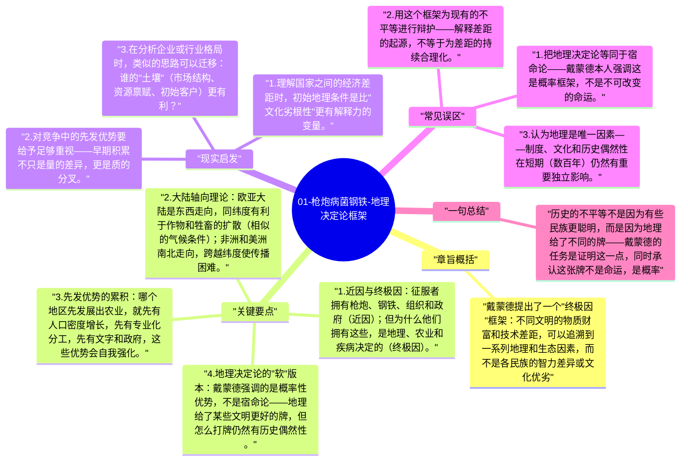

# 01-枪炮病菌钢铁-地理决定论框架

全书的出发点是一个亿万级别的问题：亚力（Yali），一位新几内亚政治家，曾问戴蒙德："为什么你们白人生产了那么多货物，带来了新几内亚，而我们黑人几乎没有属于我们自己的货物？"戴蒙德用整本书来回答：答案在地理，不在种族。

## 章旨概括

戴蒙德提出了一个"终极因"框架：不同文明的物质财富和技术差距，可以追溯到一系列地理和生态因素，而不是各民族的智力差异或文化优劣。这个框架把历史问题从"谁更聪明"转化为"谁的出发条件更好"，在学术和公共讨论上都极具争议性，也极具解释力。

## 关键要点

1. **近因与终极因**：征服者拥有枪炮、钢铁、组织和政府（近因）；但为什么他们拥有这些，是地理、农业和疾病决定的（终极因）。
2. **大陆轴向理论**：欧亚大陆是东西走向，同纬度有利于作物和牲畜的扩散（相似的气候条件）；非洲和美洲南北走向，跨越纬度使传播困难。
3. **先发优势的累积**：哪个地区先发展出农业，就先有人口密度增长，先有专业化分工，先有文字和政府，这些优势会自我强化。
4. **地理决定论的"软"版本**：戴蒙德强调的是概率性优势，不是宿命论——地理给了某些文明更好的牌，但怎么打牌仍然有历史偶然性。
5. **文明的中轴结构**：从中东"新月沃土"出发的农业、畜牧和技术，沿东西轴向快速扩散到欧洲和南亚，是早期文明加速的关键。

## 现实启发

1. 理解国家之间的经济差距时，初始地理条件是比"文化劣根性"更有解释力的变量。
2. 对竞争中的先发优势要给予足够重视——早期积累不只是量的差异，更是质的分叉。
3. 在分析企业或行业格局时，类似的思路可以迁移：谁的"土壤"（市场结构、资源禀赋、初始客户）更有利？

## 常见误区

1. 把地理决定论等同于宿命论——戴蒙德本人强调这是概率框架，不是不可改变的命运。
2. 用这个框架为现有的不平等进行辩护——解释差距的起源，不等于为差距的持续合理化。
3. 认为地理是唯一因素——制度、文化和历史偶然性在短期（数百年）仍然有重要独立影响。

## 一句总结

历史的不平等不是因为有些民族更聪明，而是因为地理给了不同的牌——戴蒙德的任务是证明这一点，同时承认这张牌不是命运，是概率。

---

## Mermaid 思维导图

### 图1

