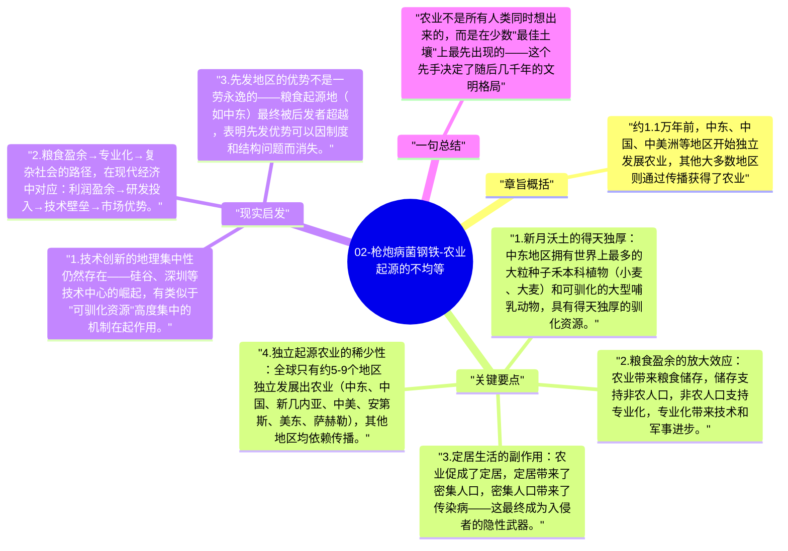

# 02-枪炮病菌钢铁-农业起源的不均等

农业并非所有地区同时独立发展的——全球独立起源农业的地点极少，大多数农业文明来自"传播"而非独立创新。而那些最早发展出农业的地区，拥有的不是更聪明的人类，而是更有利于驯化的野生植物和动物。

## 章旨概括

约1.1万年前，中东、中国、中美洲等地区开始独立发展农业，其他大多数地区则通过传播获得了农业。这种不均等的农业起源，产生了深远的文明分叉：有农业的地区有更多粮食盈余，能供养专家（工匠、士兵、官僚），从而发展出更复杂的政治和技术体系。

## 关键要点

1. **新月沃土的得天独厚**：中东地区拥有世界上最多的大粒种子禾本科植物（小麦、大麦）和可驯化的大型哺乳动物，具有得天独厚的驯化资源。
2. **粮食盈余的放大效应**：农业带来粮食储存，储存支持非农人口，非农人口支持专业化，专业化带来技术和军事进步。
3. **定居生活的副作用**：农业促成了定居，定居带来了密集人口，密集人口带来了传染病——这最终成为入侵者的隐性武器。
4. **独立起源农业的稀少性**：全球只有约5-9个地区独立发展出农业（中东、中国、新几内亚、中美、安第斯、美东、萨赫勒），其他地区均依赖传播。
5. **传播速度的差异**：农业从起源地向外传播的速度，受地理（轴向）和文化（是否接纳）双重影响，并不是匀速的。

## 现实启发

1. 技术创新的地理集中性仍然存在——硅谷、深圳等技术中心的崛起，有类似于"可驯化资源"高度集中的机制在起作用。
2. 粮食盈余→专业化→复杂社会的路径，在现代经济中对应：利润盈余→研发投入→技术壁垒→市场优势。
3. 先发地区的优势不是一劳永逸的——粮食起源地（如中东）最终被后发者超越，表明先发优势可以因制度和结构问题而消失。

## 一句总结

农业不是所有人类同时想出来的，而是在少数"最佳土壤"上最先出现的——这个先手决定了随后几千年的文明格局。

---

## Mermaid 思维导图

### 图1

