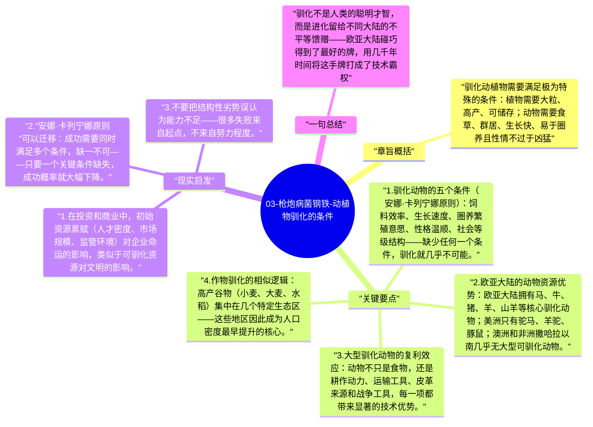

# 03-枪炮病菌钢铁-动植物驯化的条件

并非所有野生动植物都可以被驯化——驯化是高度苛刻的条件组合。中东、中国和欧亚大陆幸运地集中了世界上最多的可驯化大型哺乳动物和高产谷物，而美洲、非洲和澳洲则严重缺乏这类资源，这不是因为那里的人不够聪明，而是因为进化给那片土地发了不同的牌。

## 章旨概括

驯化动植物需要满足极为特殊的条件：植物需要大粒、高产、可储存；动物需要食草、群居、生长快、易于圈养且性情不过于凶猛。全球约148种大型陆生哺乳动物中，只有14种成功被驯化，其中13种起源于欧亚大陆。这个数字差异，是文明分叉最根本的原材料之一。

## 关键要点

1. **驯化动物的五个条件（安娜·卡列宁娜原则）**：饲料效率、生长速度、圈养繁殖意愿、性格温顺、社会等级结构——缺少任何一个条件，驯化就几乎不可能。
2. **欧亚大陆的动物资源优势**：欧亚大陆拥有马、牛、猪、羊、山羊等核心驯化动物；美洲只有驼马、羊驼、豚鼠；澳洲和非洲撒哈拉以南几乎无大型可驯化动物。
3. **大型驯化动物的复利效应**：动物不只是食物，还是耕作动力、运输工具、皮革来源和战争工具，每一项都带来显著的技术优势。
4. **作物驯化的相似逻辑**：高产谷物（小麦、大麦、水稻）集中在几个特定生态区——这些地区因此成为人口密度最早提升的核心。
5. **驯化的路径依赖**：一旦某个地区建立了农牧复合体系，它的技术扩散速度将远超依赖狩猎采集的地区，先发的优势自我强化。

## 现实启发

1. 在投资和商业中，初始资源禀赋（人才密度、市场规模、监管环境）对企业命运的影响，类似于可驯化资源对文明的影响。
2. "安娜·卡列宁娜原则"可以迁移：成功需要同时满足多个条件，缺一不可——只要一个关键条件缺失，成功概率就大幅下降。
3. 不要把结构性劣势误认为能力不足——很多失败来自起点，不来自努力程度。

## 一句总结

驯化不是人类的聪明才智，而是进化留给不同大陆的不平等馈赠——欧亚大陆碰巧得到了最好的牌，用几千年时间将这手牌打成了技术霸权。

---

## Mermaid 思维导图

### 图1

