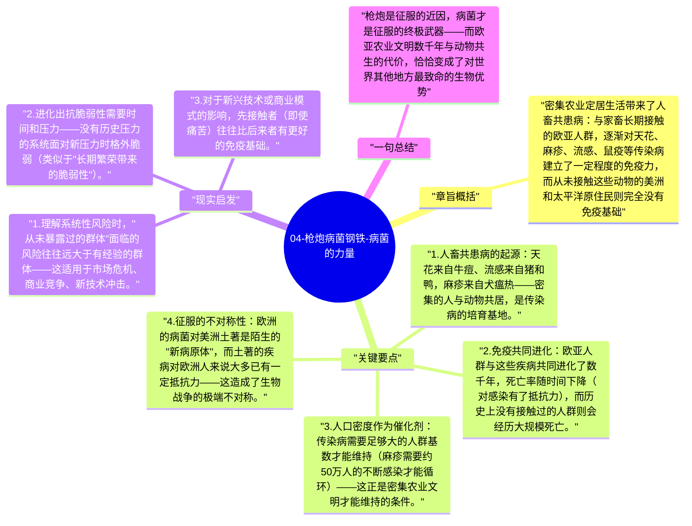

# 04-枪炮病菌钢铁-病菌的力量

西班牙征服者科尔特斯用600人征服了拥有数百万人口的阿兹特克帝国——但真正最大的杀手不是枪炮，而是天花。欧洲殖民美洲的最初几十年，传染病杀死了90%以上的美洲原住民。这不是偶然，而是农业文明与病菌之间几千年共同进化的结果。

## 章旨概括

密集农业定居生活带来了人畜共患病：与家畜长期接触的欧亚人群，逐渐对天花、麻疹、流感、鼠疫等传染病建立了一定程度的免疫力，而从未接触这些动物的美洲和太平洋原住民则完全没有免疫基础。当两种人群相遇，病菌成了最高效的征服武器，而欧洲人甚至不知道自己在用它。

## 关键要点

1. **人畜共患病的起源**：天花来自牛痘、流感来自猪和鸭，麻疹来自犬瘟热——密集的人与动物共居，是传染病的培育基地。
2. **免疫共同进化**：欧亚人群与这些疾病共同进化了数千年，死亡率随时间下降（对感染有了抵抗力），而历史上没有接触过的人群则会经历大规模死亡。
3. **人口密度作为催化剂**：传染病需要足够大的人群基数才能维持（麻疹需要约50万人的不断感染才能循环）——这正是密集农业文明才能维持的条件。
4. **征服的不对称性**：欧洲的病菌对美洲土著是陌生的"新病原体"，而土著的疾病对欧洲人来说大多已有一定抵抗力——这造成了生物战争的极端不对称。
5. **病菌在历史中的反复作用**：罗马帝国的瘟疫、蒙古西征途中的鼠疫、第一次世界大战后的流感——病菌在历史关键节点反复改变力量对比。

## 现实启发

1. 理解系统性风险时，"从未暴露过的群体"面临的风险往往远大于有经验的群体——这适用于市场危机、商业竞争、新技术冲击。
2. 进化出抗脆弱性需要时间和压力——没有历史压力的系统面对新压力时格外脆弱（类似于"长期繁荣带来的脆弱性"）。
3. 对于新兴技术或商业模式的影响，先接触者（即使痛苦）往往比后来者有更好的免疫基础。

## 一句总结

枪炮是征服的近因，病菌才是征服的终极武器——而欧亚农业文明数千年与动物共生的代价，恰恰变成了对世界其他地方最致命的生物优势。

---

## Mermaid 思维导图

### 图1

