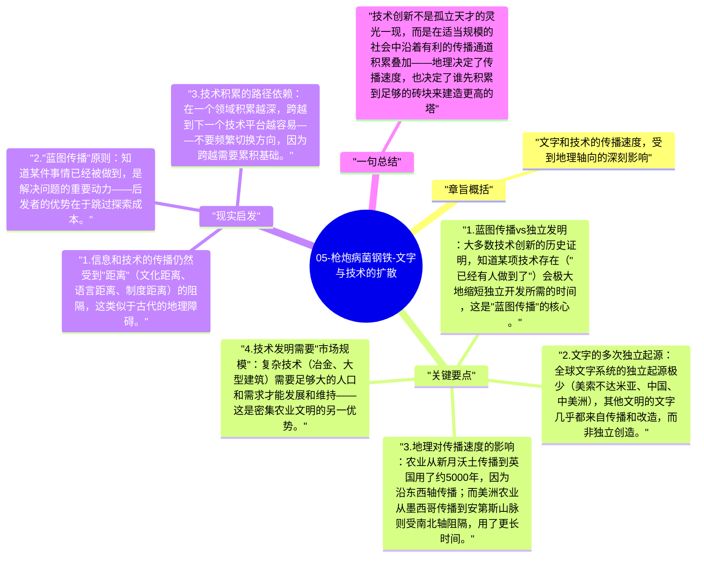

# 05-枪炮病菌钢铁-文字与技术的扩散

技术不是在所有地区独立发明的——大多数技术通过"蓝图传播"或"原理传播"从原创地扩散。欧亚大陆的东西走向使技术传播速度极快；美洲和非洲的南北走向形成了气候屏障，大幅减缓了技术扩散。

## 章旨概括

文字和技术的传播速度，受到地理轴向的深刻影响。欧亚大陆的东西轴（相同纬度）意味着相似的气候、季节长度和日照时间，农作物和牲畜可以相对容易地从西亚传播到欧洲，从中国传播到日本。而美洲从北到南跨越热带到温带，同样的作物无法直接传播，技术积累因此被阻断。

## 关键要点

1. **蓝图传播 vs 独立发明**：大多数技术创新的历史证明，知道某项技术存在（"已经有人做到了"）会极大地缩短独立开发所需的时间，这是"蓝图传播"的核心。
2. **文字的多次独立起源**：全球文字系统的独立起源极少（美索不达米亚、中国、中美洲），其他文明的文字几乎都来自传播和改造，而非独立创造。
3. **地理对传播速度的影响**：农业从新月沃土传播到英国用了约5000年，因为沿东西轴传播；而美洲农业从墨西哥传播到安第斯山脉则受南北轴阻隔，用了更长时间。
4. **技术发明需要"市场规模"**：复杂技术（冶金、大型建筑）需要足够大的人口和需求才能发展和维持——这是密集农业文明的另一优势。
5. **技术是累积性的**：后来的技术建立在先前技术之上，先发者有更大的知识基础，更容易迈出下一步。

## 现实启发

1. 信息和技术的传播仍然受到"距离"（文化距离、语言距离、制度距离）的阻隔，这类似于古代的地理障碍。
2. "蓝图传播"原则：知道某件事情已经被做到，是解决问题的重要动力——后发者的优势在于跳过探索成本。
3. 技术积累的路径依赖：在一个领域积累越深，跨越到下一个技术平台越容易——不要频繁切换方向，因为跨越需要累积基础。

## 一句总结

技术创新不是孤立天才的灵光一现，而是在适当规模的社会中沿着有利的传播通道积累叠加——地理决定了传播速度，也决定了谁先积累到足够的砖块来建造更高的塔。

---

## Mermaid 思维导图

### 图1

