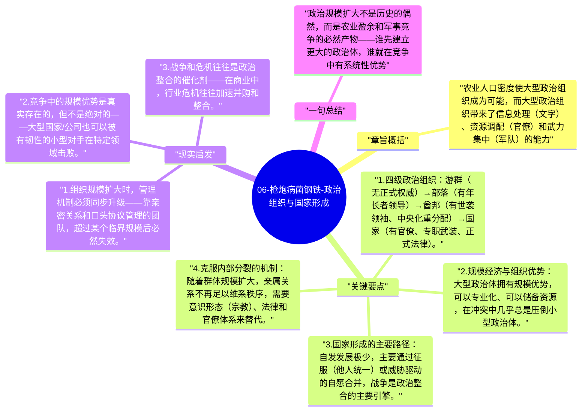

# 06-枪炮病菌钢铁-政治组织与国家形成

从游群（约25-50人）到部落（数百人）到酋邦（数千人）到国家（数万人以上），这是人类政治组织规模扩大的路径。更大的政治组织能够动员更多资源、维持专业军队和官僚体系，在与小规模社群的冲突中具有系统性优势。

## 章旨概括

农业人口密度使大型政治组织成为可能，而大型政治组织带来了信息处理（文字）、资源调配（官僚）和武力集中（军队）的能力。戴蒙德分析了从酋邦到国家转型的动力：战争和征服是主要路径，农业盈余是物质基础，集权机制是必要条件。

## 关键要点

1. **四级政治组织**：游群（无正式权威）→ 部落（有年长者领导）→ 酋邦（有世袭领袖、中央化重分配）→ 国家（有官僚、专职武装、正式法律）。
2. **规模经济与组织优势**：大型政治体拥有规模优势，可以专业化、可以储备资源，在冲突中几乎总是压倒小型政治体。
3. **国家形成的主要路径**：自发发展极少，主要通过征服（他人统一）或威胁驱动的自愿合并，战争是政治整合的主要引擎。
4. **克服内部分裂的机制**：随着群体规模扩大，亲属关系不再足以维系秩序，需要意识形态（宗教）、法律和官僚体系来替代。
5. **文字与国家的协同**：国家需要记录、税收和信息传递，文字是大型政治体运行的基础设施。

## 现实启发

1. 组织规模扩大时，管理机制必须同步升级——靠亲密关系和口头协议管理的团队，超过某个临界规模后必然失效。
2. 竞争中的规模优势是真实存在的，但不是绝对的——大型国家/公司也可以被有韧性的小型对手在特定领域击败。
3. 战争和危机往往是政治整合的催化剂——在商业中，行业危机往往加速并购和整合。

## 一句总结

政治规模扩大不是历史的偶然，而是农业盈余和军事竞争的必然产物——谁先建立更大的政治体，谁就在竞争中有系统性优势。

---

## Mermaid 思维导图

### 图1

