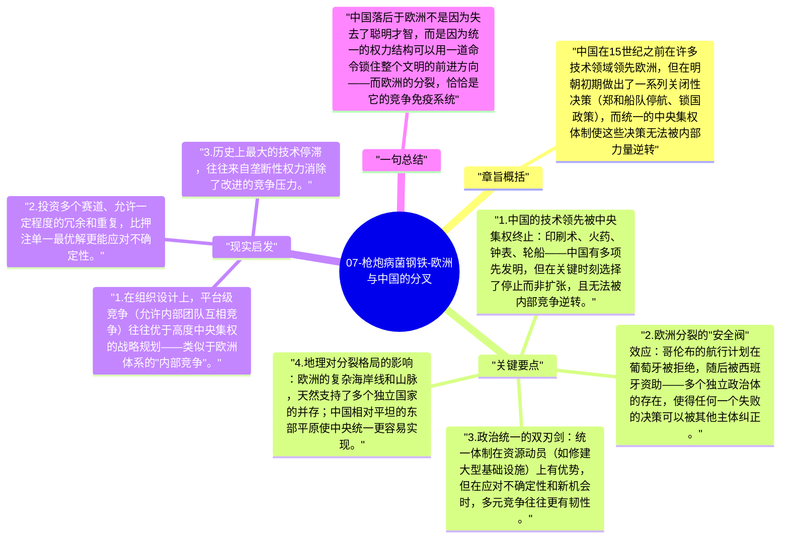

# 07-枪炮病菌钢铁-欧洲与中国的分叉

如果欧亚大陆整体占了地理优势，为什么最终是欧洲（而不是同样先进的中国）主导了全球扩张？这是戴蒙德框架面临的最尖锐挑战，他的答案在于：政治分裂本身在某些条件下是技术竞争的加速器。

## 章旨概括

中国在15世纪之前在许多技术领域领先欧洲，但在明朝初期做出了一系列关闭性决策（郑和船队停航、锁国政策），而统一的中央集权体制使这些决策无法被内部力量逆转。欧洲的政治分裂反而意味着：没有一个中央权威可以强制阻止技术探索——哥伦布在西班牙被资助，之前在葡萄牙被拒绝；欧洲的竞争压力保持了持续的技术动力。

## 关键要点

1. **中国的技术领先被中央集权终止**：印刷术、火药、钟表、轮船——中国有多项先发明，但在关键时刻选择了停止而非扩张，且无法被内部竞争逆转。
2. **欧洲分裂的"安全阀"效应**：哥伦布的航行计划在葡萄牙被拒绝，随后被西班牙资助——多个独立政治体的存在，使得任何一个失败的决策可以被其他主体纠正。
3. **政治统一的双刃剑**：统一体制在资源动员（如修建大型基础设施）上有优势，但在应对不确定性和新机会时，多元竞争往往更有韧性。
4. **地理对分裂格局的影响**：欧洲的复杂海岸线和山脉，天然支持了多个独立国家的并存；中国相对平坦的东部平原使中央统一更容易实现。
5. **最优政治规模随情境变化**：当面临外部威胁需要协调时，统一更好；当面临创新不确定性时，多元竞争更好。

## 现实启发

1. 在组织设计上，平台级竞争（允许内部团队互相竞争）往往优于高度中央集权的战略规划——类似于欧洲体系的"内部竞争"。
2. 投资多个赛道、允许一定程度的冗余和重复，比押注单一最优解更能应对不确定性。
3. 历史上最大的技术停滞，往往来自垄断性权力消除了改进的竞争压力。

## 一句总结

中国落后于欧洲不是因为失去了聪明才智，而是因为统一的权力结构可以用一道命令锁住整个文明的前进方向——而欧洲的分裂，恰恰是它的竞争免疫系统。

---

## Mermaid 思维导图

### 图1

