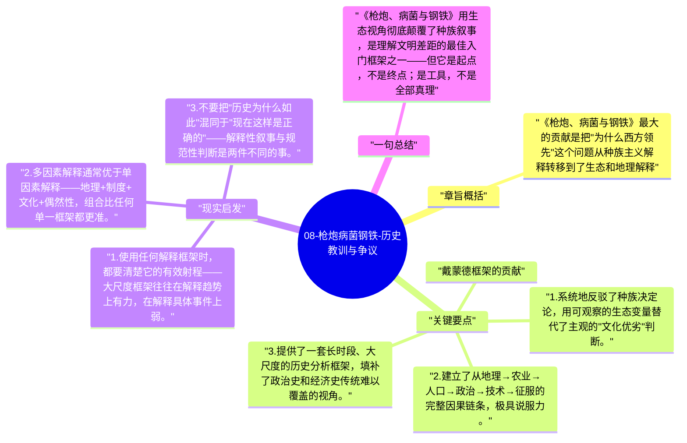

# 08-枪炮病菌钢铁-历史教训与争议

任何一本试图用"终极因"解释历史的书，都必须面对批评：简化、决定论、为现实辩护。戴蒙德的框架极具解释力，但也有明确的边界。了解这些边界，才能把这套工具用得更准。

## 章旨概括

《枪炮、病菌与钢铁》最大的贡献是把"为什么西方领先"这个问题从种族主义解释转移到了生态和地理解释。但批评者指出：它过度强调了物质条件，低估了制度、文化和历史偶然性的独立作用；而且解释历史为什么那样发展，并不等于为现在的不平等状态提供了合理性。

## 关键要点

**戴蒙德框架的贡献：**
1. 系统地反驳了种族决定论，用可观察的生态变量替代了主观的"文化优劣"判断。
2. 建立了从地理→农业→人口→政治→技术→征服的完整因果链条，极具说服力。
3. 提供了一套长时段、大尺度的历史分析框架，填补了政治史和经济史传统难以覆盖的视角。

**主要批评与局限：**
1. **过度简化制度的独立作用**：道格拉斯·诺斯等制度经济学家认为，相似地理条件下的国家（如北美与南美）有截然不同的发展轨迹，制度是关键变量。
2. **对历史偶然性的低估**：如果蒙古帝国没有西征，如果黑死病没有席卷欧洲，历史路径可能完全不同——地理框架对这些节点的解释力不足。
3. **解释力随时间尺度缩小而下降**：地理框架对千年尺度的差异有强解释力，对百年尺度的差异解释力弱很多。
4. **不能为当下不平等辩护**：即使历史上的差距有地理根源，这不意味着当前的不平等是合理的或不可改变的。

## 现实启发

1. 使用任何解释框架时，都要清楚它的有效射程——大尺度框架往往在解释趋势上有力，在解释具体事件上弱。
2. 多因素解释通常优于单因素解释——地理+制度+文化+偶然性，组合比任何单一框架都更准。
3. 不要把"历史为什么如此"混同于"现在这样是正确的"——解释性叙事与规范性判断是两件不同的事。

## 一句总结

《枪炮、病菌与钢铁》用生态视角彻底颠覆了种族叙事，是理解文明差距的最佳入门框架之一——但它是起点，不是终点；是工具，不是全部真理。

---

## Mermaid 思维导图

### 图1

