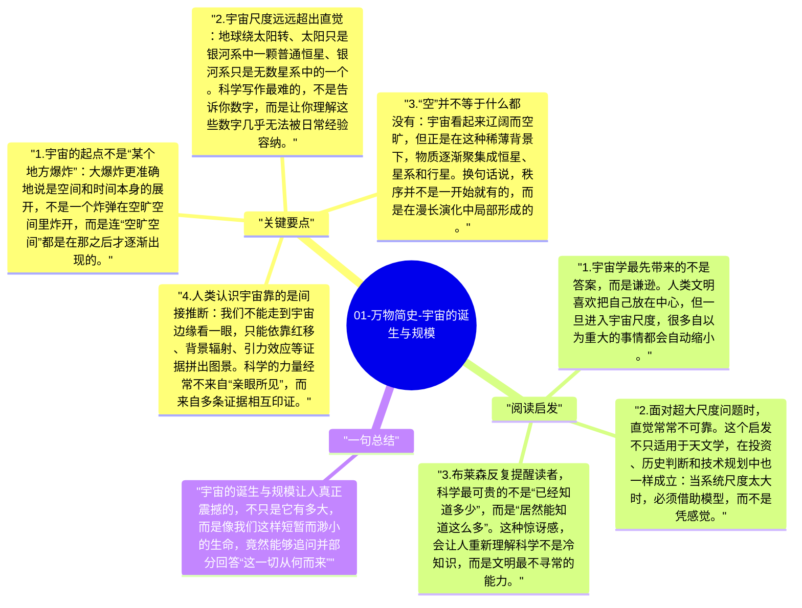

# 01-万物简史-宇宙的诞生与规模

《万物简史》一开场就把读者丢进一个几乎无法直观把握的事实里：宇宙大得离谱，而人类小得惊人。布莱森擅长的不是推公式，而是让你先感到尺度上的眩晕，再意识到科学真正厉害的地方在于，人类居然能用有限的头脑去逼近这种无边无际的现实。

## 关键要点

1. **宇宙的起点不是“某个地方爆炸”**：大爆炸更准确地说是空间和时间本身的展开，不是一个炸弹在空旷空间里炸开，而是连“空旷空间”都是在那之后才逐渐出现的。
2. **宇宙尺度远远超出直觉**：地球绕太阳转、太阳只是银河系中一颗普通恒星、银河系只是无数星系中的一个。科学写作最难的，不是告诉你数字，而是让你理解这些数字几乎无法被日常经验容纳。
3. **“空”并不等于什么都没有**：宇宙看起来辽阔而空旷，但正是在这种稀薄背景下，物质逐渐聚集成恒星、星系和行星。换句话说，秩序并不是一开始就有的，而是在漫长演化中局部形成的。
4. **人类认识宇宙靠的是间接推断**：我们不能走到宇宙边缘看一眼，只能依靠红移、背景辐射、引力效应等证据拼出图景。科学的力量经常不来自“亲眼所见”，而来自多条证据相互印证。
5. **尺度感本身就是科学素养**：理解宇宙，不只是记住“138亿年”或“光年”这些概念，而是训练一种能力：知道自己熟悉的日常世界，只是现实中极窄的一层切片。

## 阅读启发

1. 宇宙学最先带来的不是答案，而是谦逊。人类文明喜欢把自己放在中心，但一旦进入宇宙尺度，很多自以为重大的事情都会自动缩小。
2. 面对超大尺度问题时，直觉常常不可靠。这个启发不只适用于天文学，在投资、历史判断和技术规划中也一样成立：当系统尺度太大时，必须借助模型，而不是凭感觉。
3. 布莱森反复提醒读者，科学最可贵的不是“已经知道多少”，而是“居然能知道这么多”。这种惊讶感，会让人重新理解科学不是冷知识，而是文明最不寻常的能力。

## 一句总结

宇宙的诞生与规模让人真正震撼的，不只是它有多大，而是像我们这样短暂而渺小的生命，竟然能够追问并部分回答“这一切从何而来”。

---

## Mermaid 思维导图

### 图1

