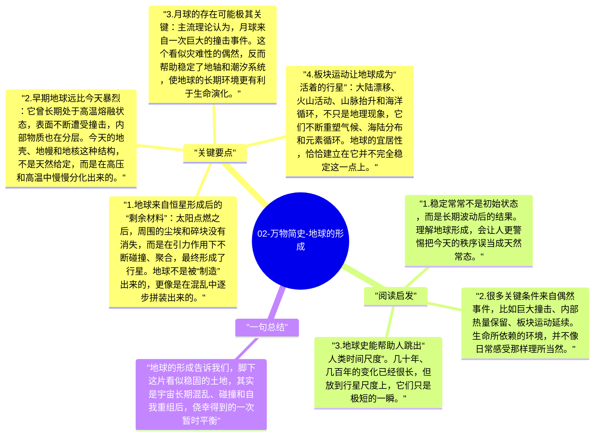

# 02-万物简史-地球的形成

如果说宇宙的尺度让人感到辽阔，那么地球的形成则让人感到侥幸。今天这颗看起来稳定、适宜居住的行星，并不是一开始就温和宁静，而是在漫长碰撞、熔融、冷却和重构中，慢慢变成了我们熟悉的样子。

## 关键要点

1. **地球来自恒星形成后的“剩余材料”**：太阳点燃之后，周围的尘埃和碎块没有消失，而是在引力作用下不断碰撞、聚合，最终形成了行星。地球不是被“制造”出来的，更像是在混乱中逐步拼装出来的。
2. **早期地球远比今天暴烈**：它曾长期处于高温熔融状态，表面不断遭受撞击，内部物质也在分层。今天的地壳、地幔和地核这种结构，不是天然给定，而是在高压和高温中慢慢分化出来的。
3. **月球的存在可能极其关键**：主流理论认为，月球来自一次巨大的撞击事件。这个看似灾难性的偶然，反而帮助稳定了地轴和潮汐系统，使地球的长期环境更有利于生命演化。
4. **板块运动让地球成为“活着的行星”**：大陆漂移、火山活动、山脉抬升和海洋循环，不只是地理现象，它们不断重塑气候、海陆分布和元素循环。地球的宜居性，恰恰建立在它并不完全稳定这一点上。
5. **大气和海洋也是逐步形成的**：地球起初并没有今天这样的空气和海水。火山逸散、温度下降、水汽凝结以及外来物质输入，共同塑造了后来的环境。所谓“地球环境”，本身就是一个缓慢生成的历史结果。

## 阅读启发

1. 稳定常常不是初始状态，而是长期波动后的结果。理解地球形成，会让人更警惕把今天的秩序误当成天然常态。
2. 很多关键条件来自偶然事件，比如巨大撞击、内部热量保留、板块运动延续。生命所依赖的环境，并不像日常感受那样理所当然。
3. 地球史能帮助人跳出“人类时间尺度”。几十年、几百年的变化已经很长，但放到行星尺度上，它们只是极短的一瞬。

## 一句总结

地球的形成告诉我们，脚下这片看似稳固的土地，其实是宇宙长期混乱、碰撞和自我重组后，侥幸得到的一次暂时平衡。

---

## Mermaid 思维导图

### 图1

