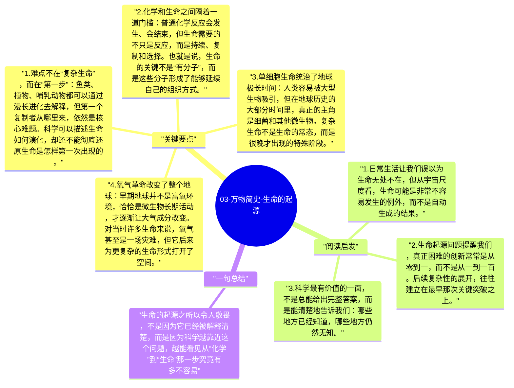

# 03-万物简史-生命的起源

在《万物简史》里，生命起源不是一个已经被完全解决的问题，而是科学仍在摸索的巨大谜团。真正令人震撼的地方在于，从无机化学到第一个能自我复制、能维持边界、能利用能量的系统，这一步看似简单，实际上可能是全书里最不可思议的跨越。

## 关键要点

1. **难点不在“复杂生命”，而在“第一步”**：鱼类、植物、哺乳动物都可以通过漫长进化去解释，但第一个复制者从哪里来，依然是核心难题。科学可以描述生命如何演化，却还不能彻底还原生命是怎样第一次出现的。
2. **化学和生命之间隔着一道门槛**：普通化学反应会发生、会结束，但生命需要的不只是反应，而是持续、复制和选择。也就是说，生命的关键不是“有分子”，而是这些分子形成了能够延续自己的组织方式。
3. **单细胞生命统治了地球极长时间**：人类容易被大型生物吸引，但在地球历史的大部分时间里，真正的主角是细菌和其他微生物。复杂生命不是生命的常态，而是很晚才出现的特殊阶段。
4. **氧气革命改变了整个地球**：早期地球并不是富氧环境，恰恰是微生物长期活动，才逐渐让大气成分改变。对当时许多生命来说，氧气甚至是一场灾难，但它后来为更复杂的生命形式打开了空间。
5. **生命史充满偶然与脆弱**：从海洋条件、温度窗口到分子稳定性，任何一个关键环节都可能失败。布莱森写这些内容时反复强调，生命不是“必然会出现”的，而更像是极其罕见的一次幸运事件。

## 阅读启发

1. 日常生活让我们误以为生命无处不在，但从宇宙尺度看，生命可能是非常不容易发生的例外，而不是自动生成的结果。
2. 生命起源问题提醒我们，真正困难的创新常常是从零到一，而不是从一到一百。后续复杂性的展开，往往建立在最早那次关键突破之上。
3. 科学最有价值的一面，不是总能给出完整答案，而是能清楚地告诉我们：哪些地方已经知道，哪些地方仍然无知。

## 一句总结

生命的起源之所以令人敬畏，不是因为它已经被解释清楚，而是因为科学越靠近这个问题，越能看见从“化学”到“生命”那一步究竟有多不容易。

---

## Mermaid 思维导图

### 图1

