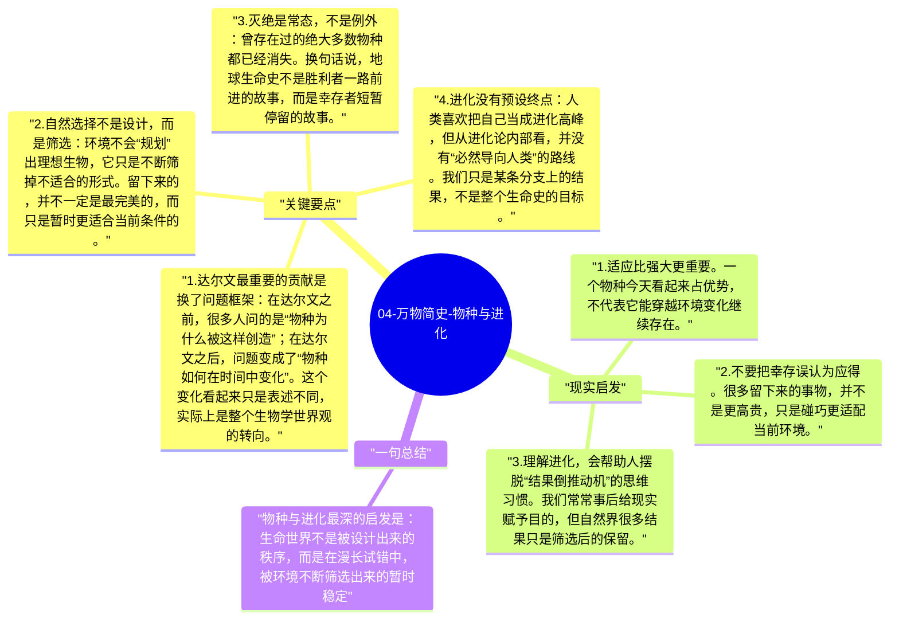

# 04-万物简史-物种与进化

进化论最容易被误读成一条“越来越高级”的直线故事，但《万物简史》呈现的图景更接近一棵不断分叉、同时大量枯萎的树。物种不是朝着某个终点前进，而是在不同环境里不断试错、适应、分化和淘汰。

## 关键要点

1. **达尔文最重要的贡献是换了问题框架**：在达尔文之前，很多人问的是“物种为什么被这样创造”；在达尔文之后，问题变成了“物种如何在时间中变化”。这个变化看起来只是表述不同，实际上是整个生物学世界观的转向。
2. **自然选择不是设计，而是筛选**：环境不会“规划”出理想生物，它只是不断筛掉不适合的形式。留下来的，并不一定是最完美的，而只是暂时更适合当前条件的。
3. **灭绝是常态，不是例外**：曾存在过的绝大多数物种都已经消失。换句话说，地球生命史不是胜利者一路前进的故事，而是幸存者短暂停留的故事。
4. **进化没有预设终点**：人类喜欢把自己当成进化高峰，但从进化论内部看，并没有“必然导向人类”的路线。我们只是某条分支上的结果，不是整个生命史的目标。
5. **进化理论的力量来自多学科汇合**：化石、地层、解剖学、遗传学和分子生物学，分别从不同方向支持同一图景。进化论之所以稳固，不是因为某一条证据决定性，而是因为很多证据拼起来互相吻合。

## 现实启发

1. 适应比强大更重要。一个物种今天看起来占优势，不代表它能穿越环境变化继续存在。
2. 不要把幸存误认为应得。很多留下来的事物，并不是更高贵，只是碰巧更适配当前环境。
3. 理解进化，会帮助人摆脱“结果倒推动机”的思维习惯。我们常常事后给现实赋予目的，但自然界很多结果只是筛选后的保留。

## 一句总结

物种与进化最深的启发是：生命世界不是被设计出来的秩序，而是在漫长试错中，被环境不断筛选出来的暂时稳定。

---

## Mermaid 思维导图

### 图1

