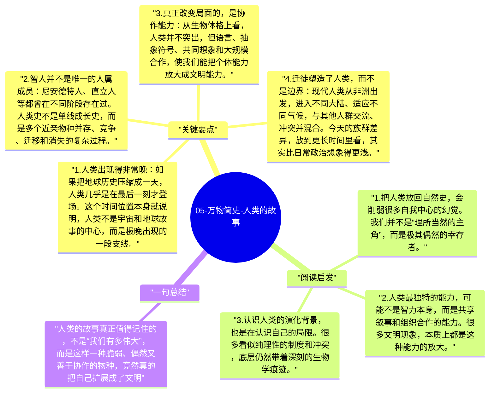

# 05-万物简史-人类的故事

《万物简史》写到人类时，真正有力量的地方不在于歌颂人类，而在于把人类放回漫长的演化背景里。这样一来，人类既显得极其特别，又显得并不必然：我们来得很晚，活得很险，而且并不是唯一曾经尝试过“做人类”的物种。

## 关键要点

1. **人类出现得非常晚**：如果把地球历史压缩成一天，人类几乎是在最后一刻才登场。这个时间位置本身就说明，人类不是宇宙和地球故事的中心，而是极晚出现的一段支线。
2. **智人并不是唯一的人属成员**：尼安德特人、直立人等都曾在不同阶段存在过。人类史不是单线成长史，而是多个近亲物种并存、竞争、迁移和消失的复杂过程。
3. **真正改变局面的，是协作能力**：从生物体格上看，人类并不突出，但语言、抽象符号、共同想象和大规模合作，使我们能把个体能力放大成文明能力。
4. **迁徙塑造了人类，而不是边界**：现代人类从非洲出发，进入不同大陆、适应不同气候，与其他人群交流、冲突并混合。今天的族群差异，放到更长时间里看，其实比日常政治想象得更浅。
5. **文明很薄，本能很深**：人类建起了城市、法律、科技和历史，但这些都建立在更古老的生物本能之上。理性并没有取消演化留下的冲动，只是给它们加了一层复杂的组织形式。

## 阅读启发

1. 把人类放回自然史，会削弱很多自我中心的幻觉。我们并不是“理所当然的主角”，而是极其偶然的幸存者。
2. 人类最独特的能力，可能不是智力本身，而是共享叙事和组织合作的能力。很多文明现象，本质上都是这种能力的放大。
3. 认识人类的演化背景，也是在认识自己的局限。很多看似纯理性的制度和冲突，底层仍然带着深刻的生物学痕迹。

## 一句总结

人类的故事真正值得记住的，不是“我们有多伟大”，而是这样一种脆弱、偶然又善于协作的物种，竟然真的把自己扩展成了文明。

---

## Mermaid 思维导图

### 图1

