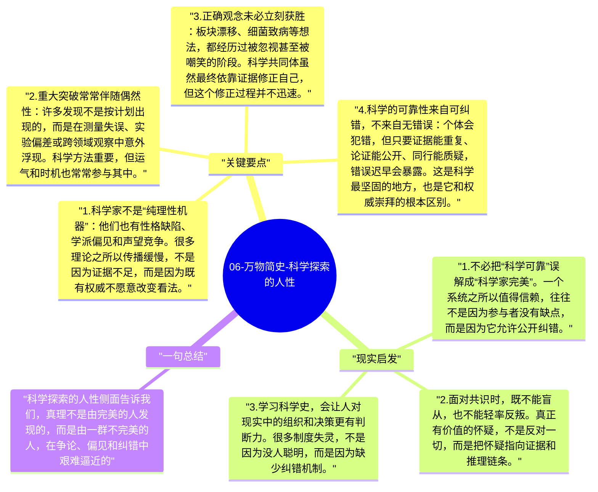

# 06-万物简史-科学探索的人性

比起单纯介绍结论，《万物简史》更特别的地方，是它不断提醒读者：科学不是由抽象理性自动推进的，而是由一群具体的人推进的。科学家会误判、争功、嫉妒、固执，也会运气极好、灵光一闪、在错误里逼近真相。正因为如此，科学史读起来才既可信又动人。

## 关键要点

1. **科学家不是“纯理性机器”**：他们也有性格缺陷、学派偏见和声望竞争。很多理论之所以传播缓慢，不是因为证据不足，而是因为既有权威不愿意改变看法。
2. **重大突破常常伴随偶然性**：许多发现不是按计划出现的，而是在测量失误、实验偏差或跨领域观察中意外浮现。科学方法重要，但运气和时机也常常参与其中。
3. **正确观念未必立刻获胜**：板块漂移、细菌致病等想法，都经历过被忽视甚至被嘲笑的阶段。科学共同体虽然最终依靠证据修正自己，但这个修正过程并不迅速。
4. **科学的可靠性来自可纠错，不来自无错误**：个体会犯错，但只要证据能重复、论证能公开、同行能质疑，错误迟早会暴露。这是科学最坚固的地方，也是它和权威崇拜的根本区别。
5. **人物故事让知识真正“可感”**：当知识被放回人的处境里，读者更容易理解一项理论为什么来得那么晚、为什么那么难、又为什么一旦成立就会改变世界。

## 现实启发

1. 不必把“科学可靠”误解成“科学家完美”。一个系统之所以值得信赖，往往不是因为参与者没有缺点，而是因为它允许公开纠错。
2. 面对共识时，既不能盲从，也不能轻率反叛。真正有价值的怀疑，不是反对一切，而是把怀疑指向证据和推理链条。
3. 学习科学史，会让人对现实中的组织和决策更有判断力。很多制度失灵，不是因为没人聪明，而是因为缺少纠错机制。

## 一句总结

科学探索的人性侧面告诉我们，真理不是由完美的人发现的，而是由一群不完美的人，在争论、偏见和纠错中艰难逼近的。

---

## Mermaid 思维导图

### 图1

