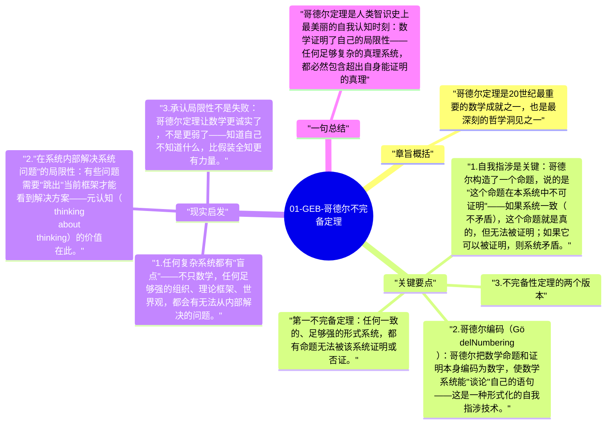

# 01-GEB-哥德尔不完备定理

1931年，25岁的库尔特·哥德尔（Kurt Gödel）证明了一个颠覆整个数学基础计划的定理：任何足够复杂的、一致的形式系统，都必然包含它自身无法证明的真命题。这意味着数学的完全公理化——希尔伯特的梦想——是不可能实现的。

## 章旨概括

哥德尔定理是20世纪最重要的数学成就之一，也是最深刻的哲学洞见之一。它证明：任何系统都有"超出自身"的真理——一个系统无法从内部完全描述自身。这个洞见被侯世达用来探索意识和自我指涉的问题。

## 关键要点

1. **自我指涉是关键**：哥德尔构造了一个命题，说的是"这个命题在本系统中不可证明"——如果系统一致（不矛盾），这个命题就是真的，但无法被证明；如果它可以被证明，则系统矛盾。
2. **哥德尔编码（Gödel Numbering）**：哥德尔把数学命题和证明本身编码为数字，使数学系统能"谈论"自己的语句——这是一种形式化的自我指涉技术。
3. **不完备性定理的两个版本**：
   - 第一不完备定理：任何一致的、足够强的形式系统，都有命题无法被该系统证明或否证。
   - 第二不完备定理：这样的系统无法证明自身的一致性。
4. **对希尔伯特计划的打击**：希尔伯特试图把所有数学形式化为完备、一致的公理系统——哥德尔定理证明这不可能同时满足。
5. **类比延伸**：侯世达将这个定理类比到意识——大脑（作为一个物理系统）是否也有"超出自身"的能力？意识是否是这种"超系统"能力的表现？

## 现实启发

1. 任何复杂系统都有"盲点"——不只数学，任何足够强的组织、理论框架、世界观，都会有无法从内部解决的问题。
2. "在系统内部解决系统问题"的局限性：有些问题需要"跳出"当前框架才能看到解决方案——元认知（thinking about thinking）的价值在此。
3. 承认局限性不是失败：哥德尔定理让数学更诚实了，不是更弱了——知道自己不知道什么，比假装全知更有力量。

## 一句总结

哥德尔定理是人类智识史上最美丽的自我认知时刻：数学证明了自己的局限性——任何足够复杂的真理系统，都必然包含超出自身能证明的真理。

---

## Mermaid 思维导图

### 图1

