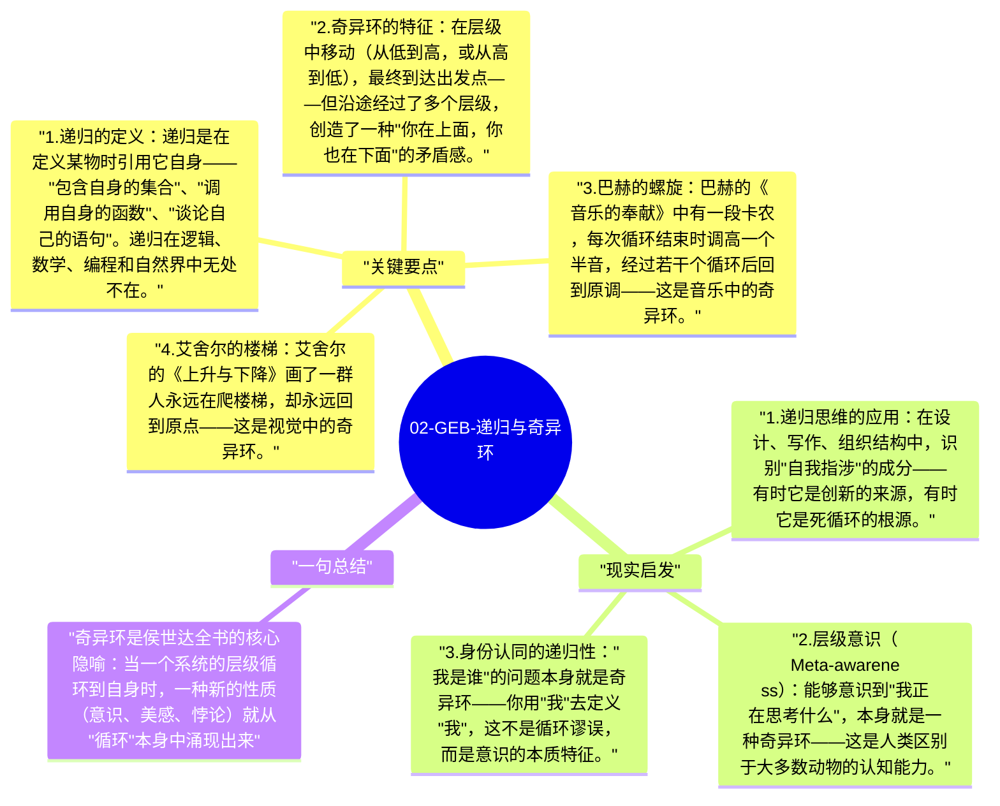

# 02-GEB-递归与奇异环

侯世达用"奇异环"（Strange Loop）来描述这样一种结构：在一个层级系统中移动，最终回到了起点——但是经过了不同的层级。哥德尔命题是一个奇异环，艾舍尔的画是视觉奇异环，巴赫的音乐有音调奇异环。侯世达认为，意识本身就是一种奇异环。

## 关键要点

1. **递归的定义**：递归是在定义某物时引用它自身——"包含自身的集合"、"调用自身的函数"、"谈论自己的语句"。递归在逻辑、数学、编程和自然界中无处不在。
2. **奇异环的特征**：在层级中移动（从低到高，或从高到低），最终到达出发点——但沿途经过了多个层级，创造了一种"你在上面，你也在下面"的矛盾感。
3. **巴赫的螺旋**：巴赫的《音乐的奉献》中有一段卡农，每次循环结束时调高一个半音，经过若干个循环后回到原调——这是音乐中的奇异环。
4. **艾舍尔的楼梯**：艾舍尔的《上升与下降》画了一群人永远在爬楼梯，却永远回到原点——这是视觉中的奇异环。
5. **意识作为奇异环**：大脑是一个处理信息的系统，其中产生了一个关于"我"的表征——这个"我"的表征反过来影响大脑的信息处理。侯世达认为，这种自我指涉的奇异环就是意识的本质。

## 现实启发

1. 递归思维的应用：在设计、写作、组织结构中，识别"自我指涉"的成分——有时它是创新的来源，有时它是死循环的根源。
2. 层级意识（Meta-awareness）：能够意识到"我正在思考什么"，本身就是一种奇异环——这是人类区别于大多数动物的认知能力。
3. 身份认同的递归性："我是谁"的问题本身就是奇异环——你用"我"去定义"我"，这不是循环谬误，而是意识的本质特征。

## 一句总结

奇异环是侯世达全书的核心隐喻：当一个系统的层级循环到自身时，一种新的性质（意识、美感、悖论）就从"循环"本身中涌现出来。

---

## Mermaid 思维导图

### 图1

