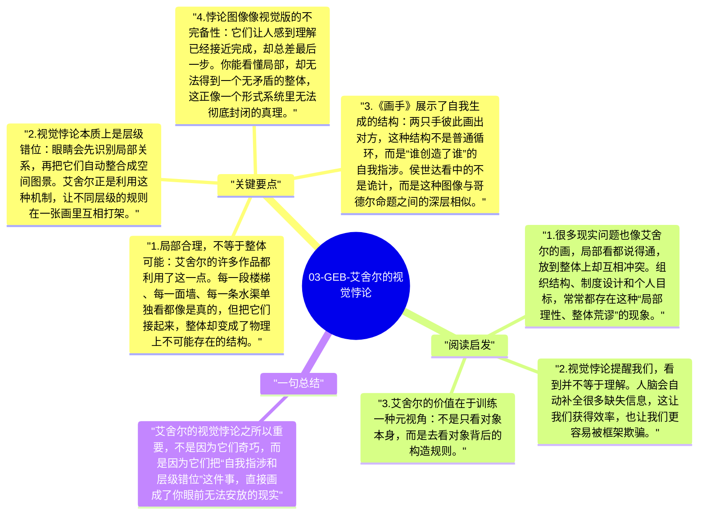

# 03-GEB-艾舍尔的视觉悖论

在《GEB》里，艾舍尔不是拿来点缀趣味的艺术家，而是侯世达论证“自我指涉”时的视觉证人。艾舍尔那些看似荒诞的版画之所以迷人，不只是因为它们“画得巧”，而是因为它们直接暴露出：我们的知觉系统，总是在主动构造一个世界，而不是被动接收世界。

## 关键要点

1. **局部合理，不等于整体可能**：艾舍尔的许多作品都利用了这一点。每一段楼梯、每一面墙、每一条水渠单独看都像是真的，但把它们接起来，整体却变成了物理上不可能存在的结构。
2. **视觉悖论本质上是层级错位**：眼睛会先识别局部关系，再把它们自动整合成空间图景。艾舍尔正是利用这种机制，让不同层级的规则在一张画里互相打架。
3. **《画手》展示了自我生成的结构**：两只手彼此画出对方，这种结构不是普通循环，而是“谁创造了谁”的自我指涉。侯世达看中的不是诡计，而是这种图像与哥德尔命题之间的深层相似。
4. **悖论图像像视觉版的不完备性**：它们让人感到理解已经接近完成，却总差最后一步。你能看懂局部，却无法得到一个无矛盾的整体，这正像一个形式系统里无法彻底封闭的真理。
5. **艺术在这里承担了认知实验的作用**：艾舍尔证明，艺术不只是表达情感，也可以像数学一样，用结构去逼出一个思想问题：当一个系统试图表现自己时，会发生什么？

## 阅读启发

1. 很多现实问题也像艾舍尔的画，局部看都说得通，放到整体上却互相冲突。组织结构、制度设计和个人目标，常常都存在这种“局部理性、整体荒谬”的现象。
2. 视觉悖论提醒我们，看到并不等于理解。人脑会自动补全很多缺失信息，这让我们获得效率，也让我们更容易被框架欺骗。
3. 艾舍尔的价值在于训练一种元视角：不是只看对象本身，而是去看对象背后的构造规则。

## 一句总结

艾舍尔的视觉悖论之所以重要，不是因为它们奇巧，而是因为它们把“自我指涉和层级错位”这件事，直接画成了你眼前无法安放的现实。

---

## Mermaid 思维导图

### 图1

