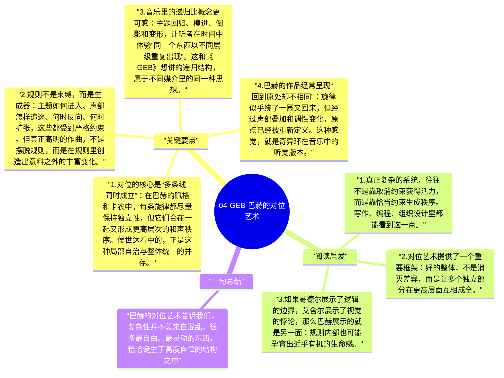

# 04-GEB-巴赫的对位艺术

侯世达把巴赫放进《GEB》，不是因为他需要一个艺术门面，而是因为巴赫的音乐展示了另一种形式系统的奇迹：严格规则并不会压扁创造力，反而能生成极高的复杂度和美感。对位音乐让人听见，秩序和自由不是对立面，结构本身可以孕育活性。

## 关键要点

1. **对位的核心是“多条线同时成立”**：在巴赫的赋格和卡农中，每条旋律都尽量保持独立性，但它们合在一起又形成更高层次的和声秩序。侯世达看中的，正是这种局部自治与整体统一的并存。
2. **规则不是束缚，而是生成器**：主题如何进入、声部怎样追逐、何时反向、何时扩张，这些都受到严格约束。但真正高明的作曲，不是摆脱规则，而是在规则里创造出意料之外的丰富变化。
3. **音乐里的递归比概念更可感**：主题回归、模进、倒影和变形，让听者在时间中体验“同一个东西以不同层级重复出现”。这和《GEB》想讲的递归结构，属于不同媒介里的同一种思想。
4. **巴赫的作品经常呈现“回到原处却不相同”**：旋律似乎绕了一圈又回来，但经过声部叠加和调性变化，原点已经被重新定义。这种感觉，就是奇异环在音乐中的听觉版本。
5. **形式系统也可以有情感张力**：侯世达借巴赫反驳了一种偏见，即有规则的东西就一定僵硬。恰恰相反，当结构足够精妙时，形式会成为情感的承载体，而不是情感的障碍。

## 阅读启发

1. 真正复杂的系统，往往不是靠取消约束获得活力，而是靠恰当约束生成秩序。写作、编程、组织设计里都能看到这一点。
2. 对位艺术提供了一个重要框架：好的整体，不是消灭差异，而是让多个独立部分在更高层面互相成全。
3. 如果哥德尔展示了逻辑的边界，艾舍尔展示了视觉的悖论，那么巴赫展示的就是另一面：规则内部也可能孕育出近乎有机的生命感。

## 一句总结

巴赫的对位艺术告诉我们，复杂性并不总来自混乱，很多最自由、最灵动的东西，恰恰诞生于高度自律的结构之中。

---

## Mermaid 思维导图

### 图1

