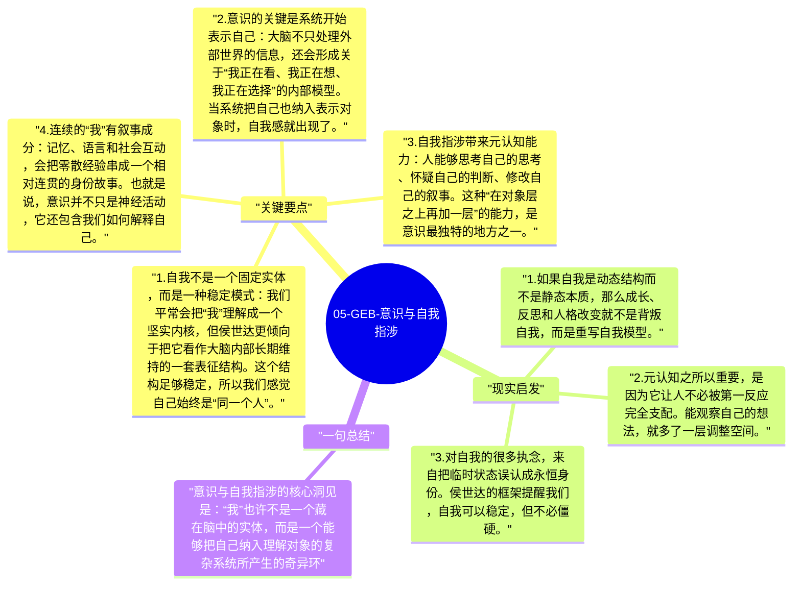

# 05-GEB-意识与自我指涉

《GEB》真正想逼近的核心问题，其实不是数学、绘画或音乐本身，而是“我”到底是什么。侯世达的答案并不神秘主义：意识可能不是一个躲在大脑里的小人，而是一个足够复杂的符号系统在处理自身时，形成的自我指涉结构。

## 关键要点

1. **自我不是一个固定实体，而是一种稳定模式**：我们平常会把“我”理解成一个坚实内核，但侯世达更倾向于把它看作大脑内部长期维持的一套表征结构。这个结构足够稳定，所以我们感觉自己始终是“同一个人”。
2. **意识的关键是系统开始表示自己**：大脑不只处理外部世界的信息，还会形成关于“我正在看、我正在想、我正在选择”的内部模型。当系统把自己也纳入表示对象时，自我感就出现了。
3. **自我指涉带来元认知能力**：人能够思考自己的思考、怀疑自己的判断、修改自己的叙事。这种“在对象层之上再加一层”的能力，是意识最独特的地方之一。
4. **连续的“我”有叙事成分**：记忆、语言和社会互动，会把零散经验串成一个相对连贯的身份故事。也就是说，意识并不只是神经活动，它还包含我们如何解释自己。
5. **这并没有把意识“解释没了”**：侯世达不是在贬低主观体验，而是在说明，主观体验可能正是复杂结构自身运转到一定程度后的结果。神秘感仍然存在，但问题被放进了可讨论的框架里。

## 现实启发

1. 如果自我是动态结构而不是静态本质，那么成长、反思和人格改变就不是背叛自我，而是重写自我模型。
2. 元认知之所以重要，是因为它让人不必被第一反应完全支配。能观察自己的想法，就多了一层调整空间。
3. 对自我的很多执念，来自把临时状态误认成永恒身份。侯世达的框架提醒我们，自我可以稳定，但不必僵硬。

## 一句总结

意识与自我指涉的核心洞见是：“我”也许不是一个藏在脑中的实体，而是一个能够把自己纳入理解对象的复杂系统所产生的奇异环。

---

## Mermaid 思维导图

### 图1

