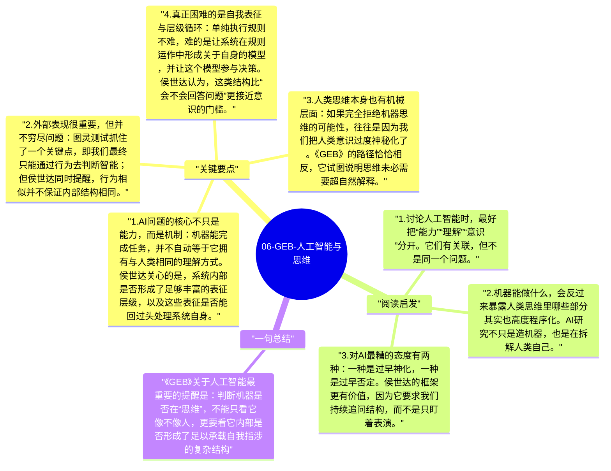

# 06-GEB-人工智能与思维

侯世达讨论人工智能时，真正关心的不是机器会不会下棋、算题或聊天，而是更困难的问题：符号操作什么时候会变成“理解”？机器如果表现得越来越像会思考，我们究竟是在看见思维本身，还是只看见一套极强的表面模拟？

## 关键要点

1. **AI问题的核心不只是能力，而是机制**：机器能完成任务，并不自动等于它拥有与人类相同的理解方式。侯世达关心的是，系统内部是否形成了足够丰富的表征层级，以及这些表征是否能回过头处理系统自身。
2. **外部表现很重要，但并不穷尽问题**：图灵测试抓住了一个关键点，即我们最终只能通过行为去判断智能；但侯世达同时提醒，行为相似并不保证内部结构相同。
3. **人类思维本身也有机械层面**：如果完全拒绝机器思维的可能性，往往是因为我们把人类意识过度神秘化了。《GEB》的路径恰恰相反，它试图说明思维未必需要超自然解释。
4. **真正困难的是自我表征与层级循环**：单纯执行规则不难，难的是让系统在规则运作中形成关于自身的模型，并让这个模型参与决策。侯世达认为，这类结构比“会不会回答问题”更接近意识的门槛。
5. **这个问题在今天反而更尖锐**：大型语言模型展示出惊人的语言流畅性，再次逼近《GEB》的核心追问。流畅不等于意识，但也不能因为它还不像人类那样自知，就简单把问题关掉。

## 阅读启发

1. 讨论人工智能时，最好把“能力”“理解”“意识”分开。它们有关联，但不是同一个问题。
2. 机器能做什么，会反过来暴露人类思维里哪些部分其实也高度程序化。AI研究不只是造机器，也是在拆解人类自己。
3. 对AI最糟的态度有两种：一种是过早神化，一种是过早否定。侯世达的框架更有价值，因为它要求我们持续追问结构，而不是只盯着表演。

## 一句总结

《GEB》关于人工智能最重要的提醒是：判断机器是否在“思维”，不能只看它像不像人，更要看它内部是否形成了足以承载自我指涉的复杂结构。

---

## Mermaid 思维导图

### 图1

