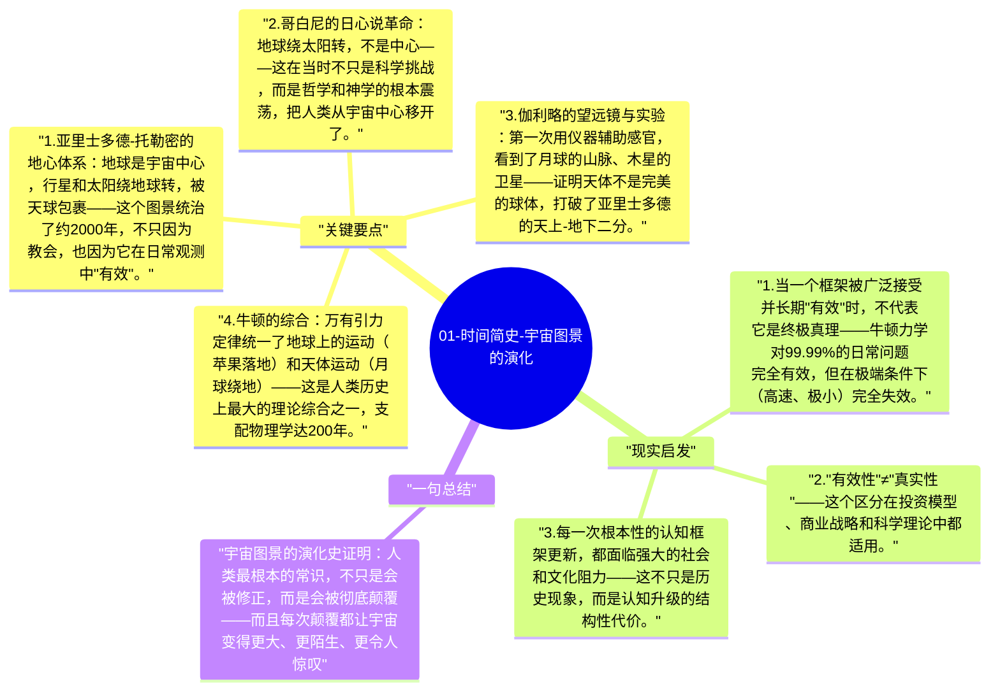

# 01-时间简史-宇宙图景的演化

人类对宇宙的理解，经历了从地心说到日心说到广义相对论的多次根本性革命。每一次革命都不是细节的修正，而是整个图景框架的颠覆——这是理解科学进步最重要的视角之一。

## 关键要点

1. **亚里士多德-托勒密的地心体系**：地球是宇宙中心，行星和太阳绕地球转，被天球包裹——这个图景统治了约2000年，不只因为教会，也因为它在日常观测中"有效"。
2. **哥白尼的日心说革命**：地球绕太阳转，不是中心——这在当时不只是科学挑战，而是哲学和神学的根本震荡，把人类从宇宙中心移开了。
3. **伽利略的望远镜与实验**：第一次用仪器辅助感官，看到了月球的山脉、木星的卫星——证明天体不是完美的球体，打破了亚里士多德的天上-地下二分。
4. **牛顿的综合**：万有引力定律统一了地球上的运动（苹果落地）和天体运动（月球绕地）——这是人类历史上最大的理论综合之一，支配物理学达200年。
5. **范式转换（Paradigm Shift）**：科学进步不是线性积累，而是周期性的"革命"——旧框架积累了无法解释的异常，最终被新框架替代，这是库恩科学革命理论的核心。

## 现实启发

1. 当一个框架被广泛接受并长期"有效"时，不代表它是终极真理——牛顿力学对99.99%的日常问题完全有效，但在极端条件下（高速、极小）完全失效。
2. "有效性"≠"真实性"——这个区分在投资模型、商业战略和科学理论中都适用。
3. 每一次根本性的认知框架更新，都面临强大的社会和文化阻力——这不只是历史现象，而是认知升级的结构性代价。

## 一句总结

宇宙图景的演化史证明：人类最根本的常识，不只是会被修正，而是会被彻底颠覆——而且每次颠覆都让宇宙变得更大、更陌生、更令人惊叹。

---

## Mermaid 思维导图

### 图1

