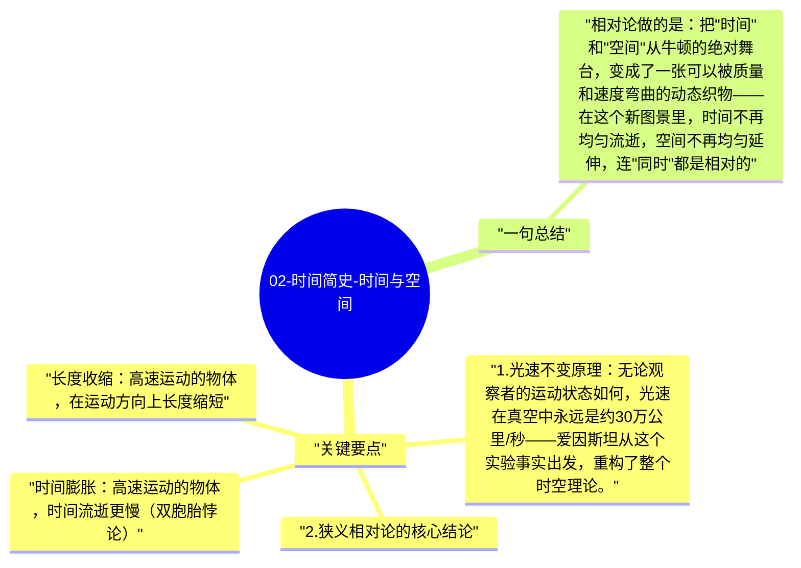

# 02-时间简史-时间与空间

爱因斯坦的相对论是有史以来对"时间"和"空间"的最根本性革命——时间和空间不是牛顿以为的绝对的舞台，而是相对的、可弯曲的、由质量和速度决定的动态实体。

## 关键要点

1. **光速不变原理**：无论观察者的运动状态如何，光速在真空中永远是约30万公里/秒——爱因斯坦从这个实验事实出发，重构了整个时空理论。
2. **狭义相对论的核心结论**：
   - 时间膨胀：高速运动的物体，时间流逝更慢（双胞胎悖论）
   - 长度收缩：高速运动的物体，在运动方向上长度缩短
   - 质能等价：$E = mc^2$——质量和能量是同一事物的两种形式
3. **广义相对论**：引力不是力，而是质量弯曲了时空——地球绕太阳转不是因为受到引力"拉着"，而是因为太阳弯曲了周围的时空，地球沿着弯曲的时空运动。
4. **时间的相对性**：没有绝对的"同时"——两个事件在一个参考系中同时发生，在另一个参考系中可能不同时。时间不是普遍流逝的背景，而是依赖于参考系。
5. **GPS的相对论校正**：GPS卫星必须考虑相对论效应（卫星运动导致时间膨胀 + 引力场减弱导致时间加速），每天约校正38微秒——相对论不是抽象理论，而是日常技术的基础。

## 一句总结

相对论做的是：把"时间"和"空间"从牛顿的绝对舞台，变成了一张可以被质量和速度弯曲的动态织物——在这个新图景里，时间不再均匀流逝，空间不再均匀延伸，连"同时"都是相对的。

---

## Mermaid 思维导图

### 图1

