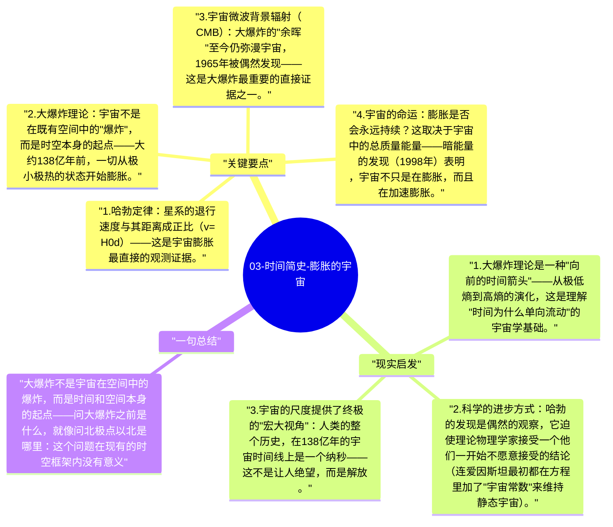

# 03-时间简史-膨胀的宇宙

1929年，哈勃发现所有星系都在远离我们，而且越远的星系速度越快——这个发现意味着宇宙在膨胀，反推回去，它有一个开始，即"大爆炸"（Big Bang）。

## 关键要点

1. **哈勃定律**：星系的退行速度与其距离成正比（$v = H_0 d$）——这是宇宙膨胀最直接的观测证据。
2. **大爆炸理论**：宇宙不是在既有空间中的"爆炸"，而是时空本身的起点——大约138亿年前，一切从极小极热的状态开始膨胀。
3. **宇宙微波背景辐射（CMB）**：大爆炸的"余晖"至今仍弥漫宇宙，1965年被偶然发现——这是大爆炸最重要的直接证据之一。
4. **宇宙的命运**：膨胀是否会永远持续？这取决于宇宙中的总质量能量——暗能量的发现（1998年）表明，宇宙不只是在膨胀，而且在加速膨胀。
5. **奇点问题**：大爆炸的"起点"（奇点）是时空理论失效的地方——广义相对论在那里不再适用，需要量子引力理论来描述，这个理论至今尚未完成。

## 现实启发

1. 大爆炸理论是一种"向前的时间箭头"——从极低熵到高熵的演化，这是理解"时间为什么单向流动"的宇宙学基础。
2. 科学的进步方式：哈勃的发现是偶然的观察，它迫使理论物理学家接受一个他们一开始不愿意接受的结论（连爱因斯坦最初都在方程里加了"宇宙常数"来维持静态宇宙）。
3. 宇宙的尺度提供了终极的"宏大视角"：人类的整个历史，在138亿年的宇宙时间线上是一个纳秒——这不是让人绝望，而是解放。

## 一句总结

大爆炸不是宇宙在空间中的爆炸，而是时间和空间本身的起点——问大爆炸之前是什么，就像问北极点以北是哪里：这个问题在现有的时空框架内没有意义。

---

## Mermaid 思维导图

### 图1

