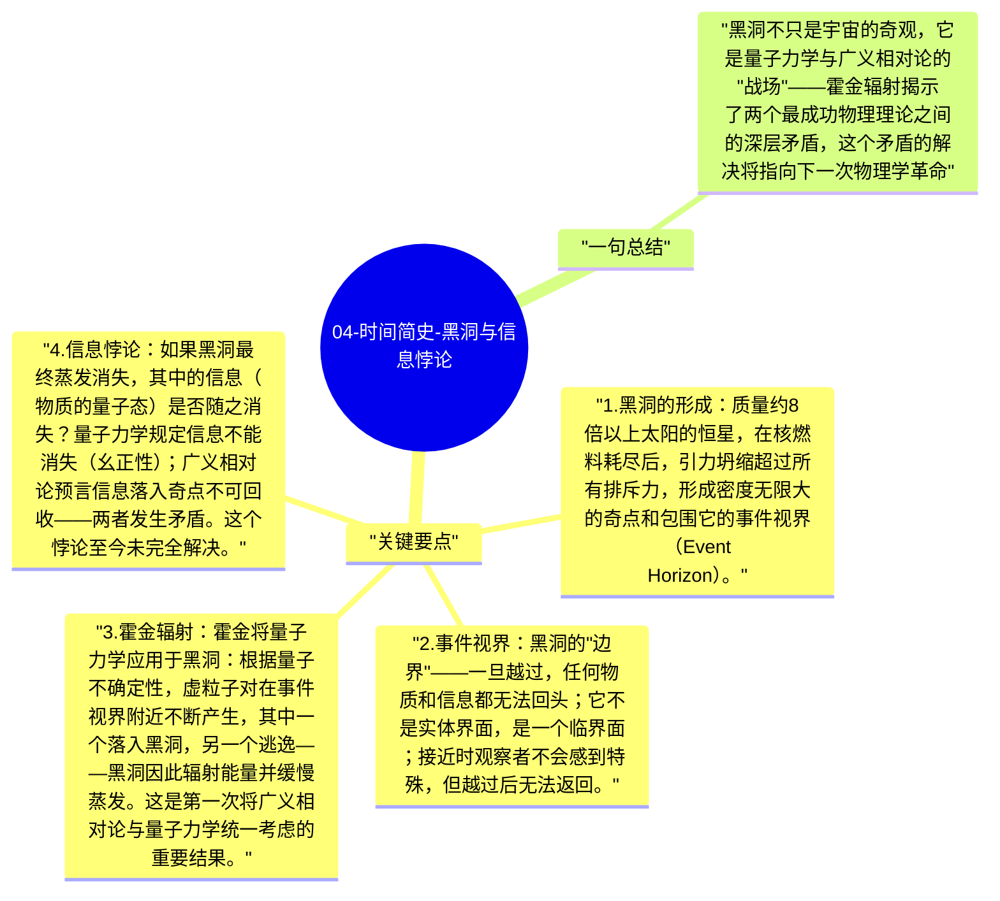

# 04-时间简史-黑洞与信息悖论

黑洞是广义相对论最奇特的预言：质量足够大的恒星在引力坍缩后，形成一个连光都无法逃逸的时空区域。霍金的贡献不只是对黑洞的研究，更是发现了量子力学和广义相对论在黑洞处的关键矛盾——霍金辐射和信息悖论。

## 关键要点

1. **黑洞的形成**：质量约8倍以上太阳的恒星，在核燃料耗尽后，引力坍缩超过所有排斥力，形成密度无限大的奇点和包围它的事件视界（Event Horizon）。
2. **事件视界**：黑洞的"边界"——一旦越过，任何物质和信息都无法回头；它不是实体界面，是一个临界面；接近时观察者不会感到特殊，但越过后无法返回。
3. **霍金辐射**：霍金将量子力学应用于黑洞：根据量子不确定性，虚粒子对在事件视界附近不断产生，其中一个落入黑洞，另一个逃逸——黑洞因此辐射能量并缓慢蒸发。**这是第一次将广义相对论与量子力学统一考虑的重要结果**。
4. **信息悖论**：如果黑洞最终蒸发消失，其中的信息（物质的量子态）是否随之消失？量子力学规定信息不能消失（幺正性）；广义相对论预言信息落入奇点不可回收——两者发生矛盾。这个悖论至今未完全解决。
5. **黑洞热力学**：黑洞遵守类似热力学的定律——事件视界面积类比熵，霍金辐射温度与黑洞质量成反比（越小越热）；这提示宇宙信息可能被编码在视界表面。

## 一句总结

黑洞不只是宇宙的奇观，它是量子力学与广义相对论的"战场"——霍金辐射揭示了两个最成功物理理论之间的深层矛盾，这个矛盾的解决将指向下一次物理学革命。

---

## Mermaid 思维导图

### 图1

