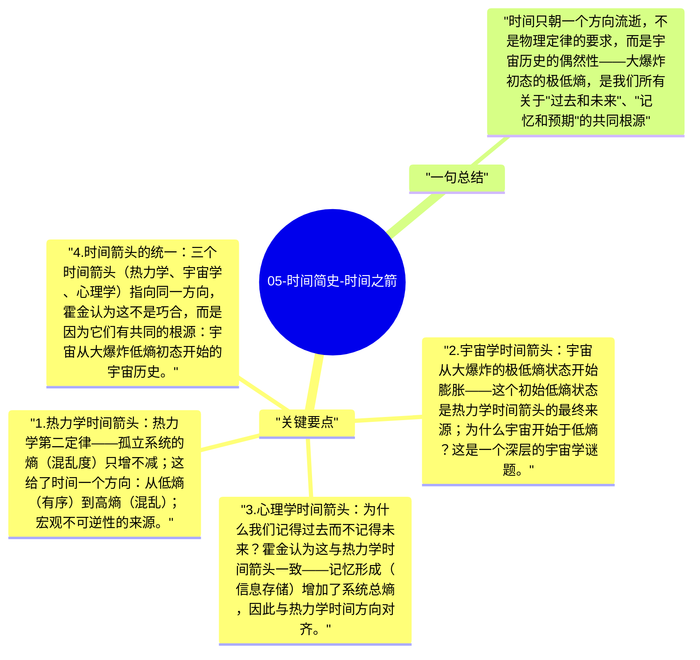

# 05-时间简史-时间之箭

为什么时间只朝一个方向流逝？物理定律在微观层面是时间对称的（正向播放和逆向播放都满足物理方程），但宏观上我们只经历"过去→未来"——打碎的杯子不会自动复原，热量不会从冷处流向热处。霍金探讨了这一"时间箭头"问题的深层根源。

## 关键要点

1. **热力学时间箭头**：热力学第二定律——孤立系统的熵（混乱度）只增不减；这给了时间一个方向：从低熵（有序）到高熵（混乱）；宏观不可逆性的来源。
2. **宇宙学时间箭头**：宇宙从大爆炸的极低熵状态开始膨胀——这个初始低熵状态是热力学时间箭头的最终来源；为什么宇宙开始于低熵？这是一个深层的宇宙学谜题。
3. **心理学时间箭头**：为什么我们记得过去而不记得未来？霍金认为这与热力学时间箭头一致——记忆形成（信息存储）增加了系统总熵，因此与热力学时间方向对齐。
4. **时间箭头的统一**：三个时间箭头（热力学、宇宙学、心理学）指向同一方向，霍金认为这不是巧合，而是因为它们有共同的根源：宇宙从大爆炸低熵初态开始的宇宙历史。
5. **无边界宇宙与时间**：在霍金-哈特尔的"无边界提议"中，宇宙的"开始"不是一个有边界的奇点，而是类似地球南极——空间上有意义，但不是"之前有什么"的边界问题。

## 一句总结

时间只朝一个方向流逝，不是物理定律的要求，而是宇宙历史的偶然性——大爆炸初态的极低熵，是我们所有关于"过去和未来"、"记忆和预期"的共同根源。

---

## Mermaid 思维导图

### 图1

