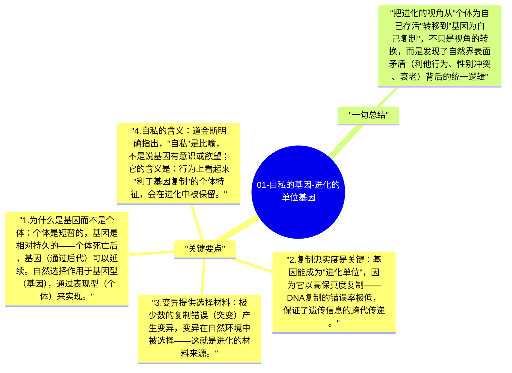

# 01-自私的基因-进化的单位基因

道金斯的核心论点是：自然选择的基本单位是基因，不是个体，不是物种，不是群体。"自私的基因"意味着：那些在历史上成功复制自己的基因，造就了今天的生物世界——基因的"目标"（用比喻的方式说）就是复制，一切生物的行为都可以从这个视角来理解。

## 关键要点

1. **为什么是基因而不是个体**：个体是短暂的，基因是相对持久的——个体死亡后，基因（通过后代）可以延续。自然选择作用于基因型（基因），通过表现型（个体）来实现。
2. **复制忠实度是关键**：基因能成为"进化单位"，因为它以高保真度复制——DNA复制的错误率极低，保证了遗传信息的跨代传递。
3. **变异提供选择材料**：极少数的复制错误（突变）产生变异，变异在自然环境中被选择——这就是进化的材料来源。
4. **自私的含义**：道金斯明确指出，"自私"是比喻，不是说基因有意识或欲望；它的含义是：行为上看起来"利于基因复制"的个体特征，会在进化中被保留。
5. **群体选择的批判**："为了物种的利益"的行为在进化上是不稳定的——如果有个体基因"欺骗"（享受群体合作的好处而不付出代价），它的基因会更快传播，最终破坏群体合作。

## 一句总结

把进化的视角从"个体为自己存活"转移到"基因为自己复制"，不只是视角的转换，而是发现了自然界表面矛盾（利他行为、性别冲突、衰老）背后的统一逻辑。

---

## Mermaid 思维导图

### 图1

