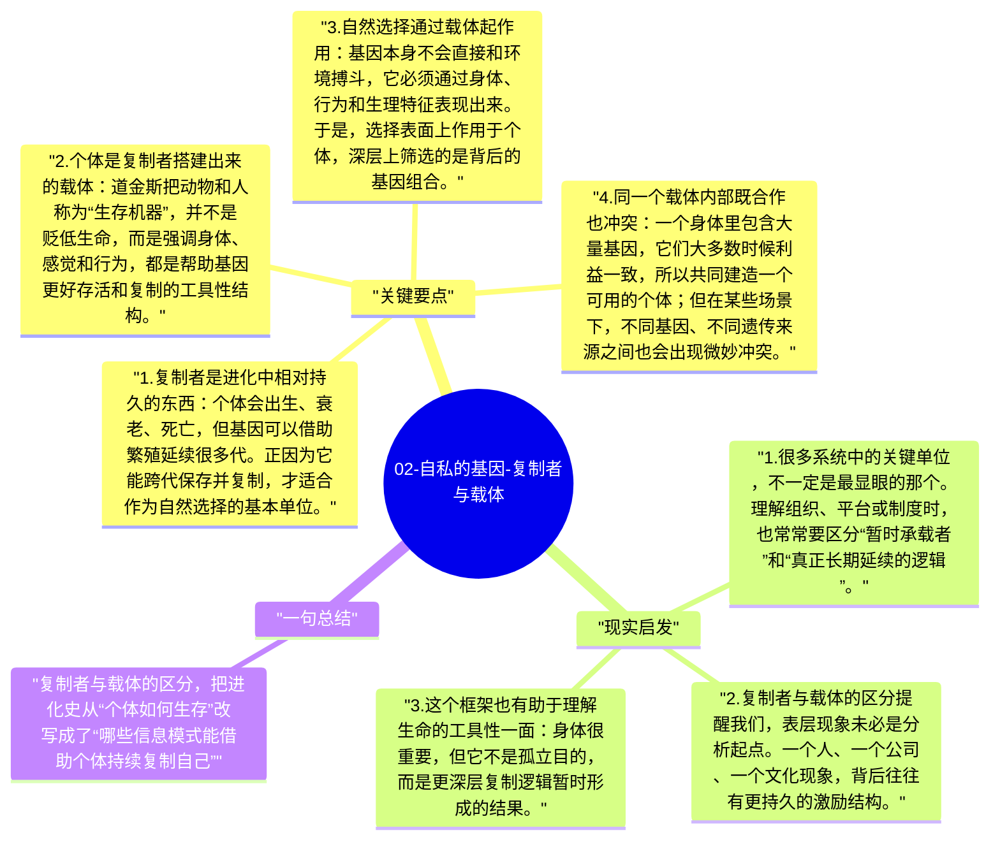

# 02-自私的基因-复制者与载体

道金斯为了让“基因视角”真正站稳，提出了一个非常关键的区分：复制者和载体。复制者是能跨代延续的信息单位，载体则是它们暂时借用来生存、竞争和传播自己的“机器”。这个区分一旦成立，很多生物学现象的解释角度就会彻底变化。

## 关键要点

1. **复制者是进化中相对持久的东西**：个体会出生、衰老、死亡，但基因可以借助繁殖延续很多代。正因为它能跨代保存并复制，才适合作为自然选择的基本单位。
2. **个体是复制者搭建出来的载体**：道金斯把动物和人称为“生存机器”，并不是贬低生命，而是强调身体、感觉和行为，都是帮助基因更好存活和复制的工具性结构。
3. **自然选择通过载体起作用**：基因本身不会直接和环境搏斗，它必须通过身体、行为和生理特征表现出来。于是，选择表面上作用于个体，深层上筛选的是背后的基因组合。
4. **同一个载体内部既合作也冲突**：一个身体里包含大量基因，它们大多数时候利益一致，所以共同建造一个可用的个体；但在某些场景下，不同基因、不同遗传来源之间也会出现微妙冲突。
5. **这个视角能重写“谁在为谁服务”**：传统直觉以为基因是身体的一部分，身体才是主角；道金斯反过来说，身体更像是基因临时组织起来的载具。这个倒置，正是全书最颠覆的地方。

## 现实启发

1. 很多系统中的关键单位，不一定是最显眼的那个。理解组织、平台或制度时，也常常要区分“暂时承载者”和“真正长期延续的逻辑”。
2. 复制者与载体的区分提醒我们，表层现象未必是分析起点。一个人、一个公司、一个文化现象，背后往往有更持久的激励结构。
3. 这个框架也有助于理解生命的工具性一面：身体很重要，但它不是孤立目的，而是更深层复制逻辑暂时形成的结果。

## 一句总结

复制者与载体的区分，把进化史从“个体如何生存”改写成了“哪些信息模式能借助个体持续复制自己”。

---

## Mermaid 思维导图

### 图1

