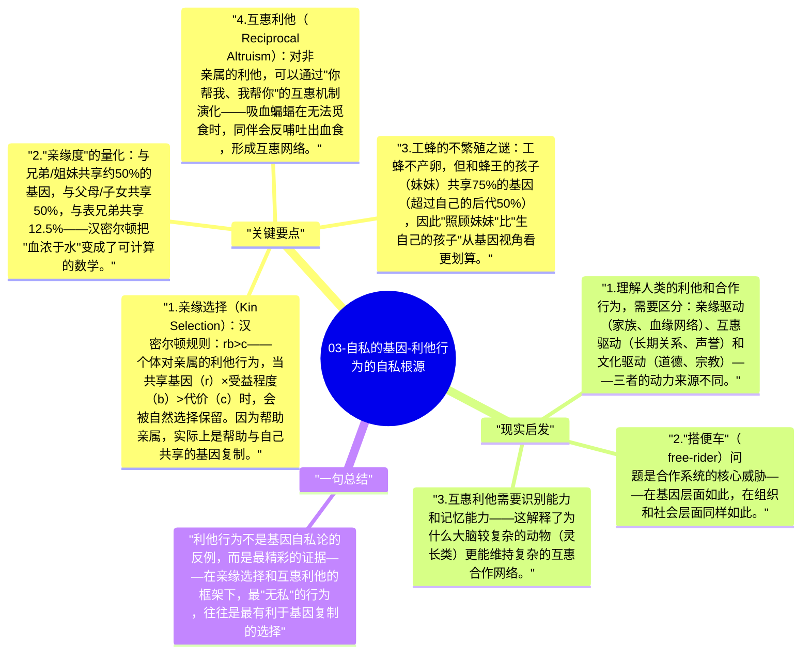

# 03-自私的基因-利他行为的自私根源

《自私的基因》最令人惊讶的论点之一：自然界中的"利他行为"（如父母为子女牺牲、工蜂不繁殖），不是反驳基因自私论的反例，而是基因自私逻辑在特定条件下的产物。

## 关键要点

1. **亲缘选择（Kin Selection）**：汉密尔顿规则：$rb > c$——个体对亲属的利他行为，当共享基因（r）×受益程度（b）> 代价（c）时，会被自然选择保留。因为帮助亲属，实际上是帮助与自己共享的基因复制。
2. **"亲缘度"的量化**：与兄弟/姐妹共享约50%的基因，与父母/子女共享50%，与表兄弟共享12.5%——汉密尔顿把"血浓于水"变成了可计算的数学。
3. **工蜂的不繁殖之谜**：工蜂不产卵，但和蜂王的孩子（妹妹）共享75%的基因（超过自己的后代50%），因此"照顾妹妹"比"生自己的孩子"从基因视角看更划算。
4. **互惠利他（Reciprocal Altruism）**：对非亲属的利他，可以通过"你帮我、我帮你"的互惠机制演化——吸血蝙蝠在无法觅食时，同伴会反哺吐出血食，形成互惠网络。
5. **利他行为的边界**：道金斯区分"真利他"（违背自身基因利益的利他）和"基因利他"（看似利他但实质推动基因复制）——后者是自然界真正发生的。

## 现实启发

1. 理解人类的利他和合作行为，需要区分：亲缘驱动（家族、血缘网络）、互惠驱动（长期关系、声誉）和文化驱动（道德、宗教）——三者的动力来源不同。
2. "搭便车"（free-rider）问题是合作系统的核心威胁——在基因层面如此，在组织和社会层面同样如此。
3. 互惠利他需要识别能力和记忆能力——这解释了为什么大脑较复杂的动物（灵长类）更能维持复杂的互惠合作网络。

## 一句总结

利他行为不是基因自私论的反例，而是最精彩的证据——在亲缘选择和互惠利他的框架下，最"无私"的行为，往往是最有利于基因复制的选择。

---

## Mermaid 思维导图

### 图1

