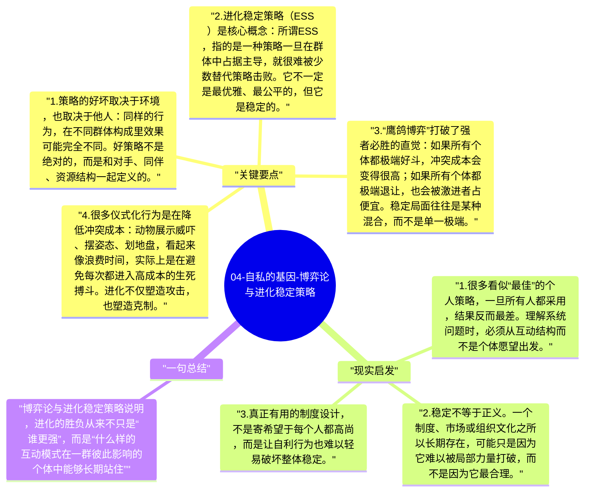

# 04-自私的基因-博弈论与进化稳定策略

《自私的基因》真正厉害的一点，是它没有把进化讲成“谁更强谁就赢”的粗糙故事。引入博弈论之后，道金斯说明：一个行为策略能否在自然界中存活，往往取决于周围其他个体采取什么策略。换句话说，进化不是单人竞技，而是相互塑造的局面。

## 关键要点

1. **策略的好坏取决于环境，也取决于他人**：同样的行为，在不同群体构成里效果可能完全不同。好策略不是绝对的，而是和对手、同伴、资源结构一起定义的。
2. **进化稳定策略（ESS）是核心概念**：所谓 ESS，指的是一种策略一旦在群体中占据主导，就很难被少数替代策略击败。它不一定是最优雅、最公平的，但它是稳定的。
3. **“鹰鸽博弈”打破了强者必胜的直觉**：如果所有个体都极端好斗，冲突成本会变得很高；如果所有个体都极端退让，也会被激进者占便宜。稳定局面往往是某种混合，而不是单一极端。
4. **很多仪式化行为是在降低冲突成本**：动物展示威吓、摆姿态、划地盘，看起来像浪费时间，实际上是在避免每次都进入高成本的生死搏斗。进化不仅塑造攻击，也塑造克制。
5. **合作和报复都可以被进化出来**：只要某种互动态势足够稳定，合作、报复、试探和容错都可能成为可保留的策略。进化并不偏爱“善”或“恶”，它偏爱可持续的结构。

## 现实启发

1. 很多看似“最佳”的个人策略，一旦所有人都采用，结果反而最差。理解系统问题时，必须从互动结构而不是个体愿望出发。
2. 稳定不等于正义。一个制度、市场或组织文化之所以长期存在，可能只是因为它难以被局部力量打破，而不是因为它最合理。
3. 真正有用的制度设计，不是寄希望于每个人都高尚，而是让自利行为也难以轻易破坏整体稳定。

## 一句总结

博弈论与进化稳定策略说明，进化的胜负从来不只是“谁更强”，而是“什么样的互动模式在一群彼此影响的个体中能够长期站住”。

---

## Mermaid 思维导图

### 图1

