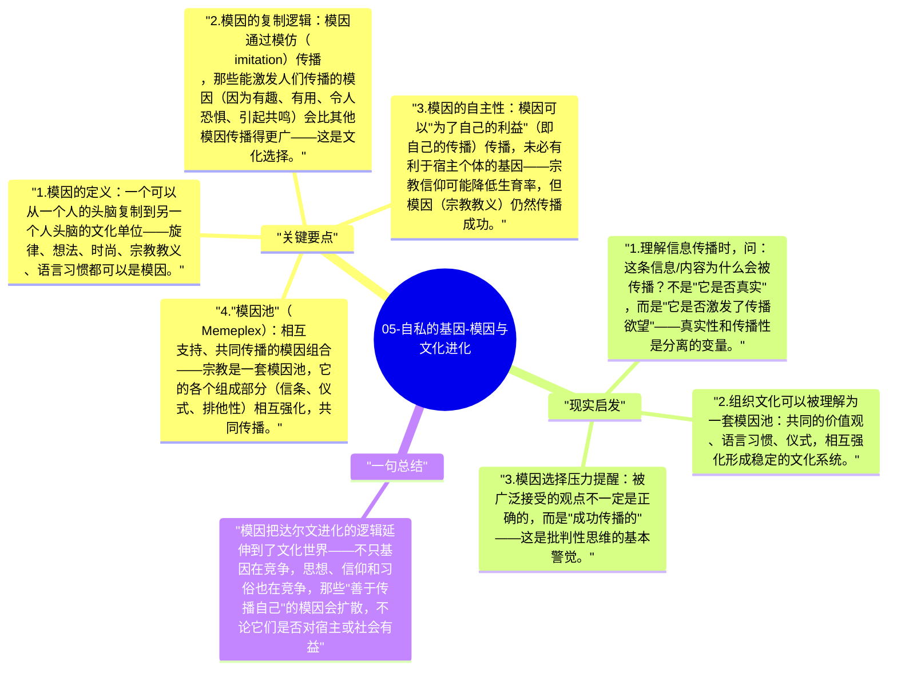

# 05-自私的基因-模因与文化进化

《自私的基因》的最后一章介绍了道金斯最具争议也最有影响力的概念之一：模因（Meme）。模因是文化信息的复制单位，类比基因，它通过人脑之间的传播而复制，并经历自己的"选择"压力。

## 关键要点

1. **模因的定义**：一个可以从一个人的头脑复制到另一个人头脑的文化单位——旋律、想法、时尚、宗教教义、语言习惯都可以是模因。
2. **模因的复制逻辑**：模因通过模仿（imitation）传播，那些能激发人们传播的模因（因为有趣、有用、令人恐惧、引起共鸣）会比其他模因传播得更广——这是文化选择。
3. **模因的自主性**：模因可以"为了自己的利益"（即自己的传播）传播，未必有利于宿主个体的基因——宗教信仰可能降低生育率，但模因（宗教教义）仍然传播成功。
4. **"模因池"（Memeplex）**：相互支持、共同传播的模因组合——宗教是一套模因池，它的各个组成部分（信条、仪式、排他性）相互强化，共同传播。
5. **模因的现代影响**：互联网和社交媒体是模因传播的超级加速器——病毒式传播的内容、表情包、流行语，都是模因动力学的现代表现。

## 现实启发

1. 理解信息传播时，问：这条信息/内容为什么会被传播？不是"它是否真实"，而是"它是否激发了传播欲望"——真实性和传播性是分离的变量。
2. 组织文化可以被理解为一套模因池：共同的价值观、语言习惯、仪式，相互强化形成稳定的文化系统。
3. 模因选择压力提醒：被广泛接受的观点不一定是正确的，而是"成功传播的"——这是批判性思维的基本警觉。

## 一句总结

模因把达尔文进化的逻辑延伸到了文化世界——不只基因在竞争，思想、信仰和习俗也在竞争，那些"善于传播自己"的模因会扩散，不论它们是否对宿主或社会有益。

---

## Mermaid 思维导图

### 图1

