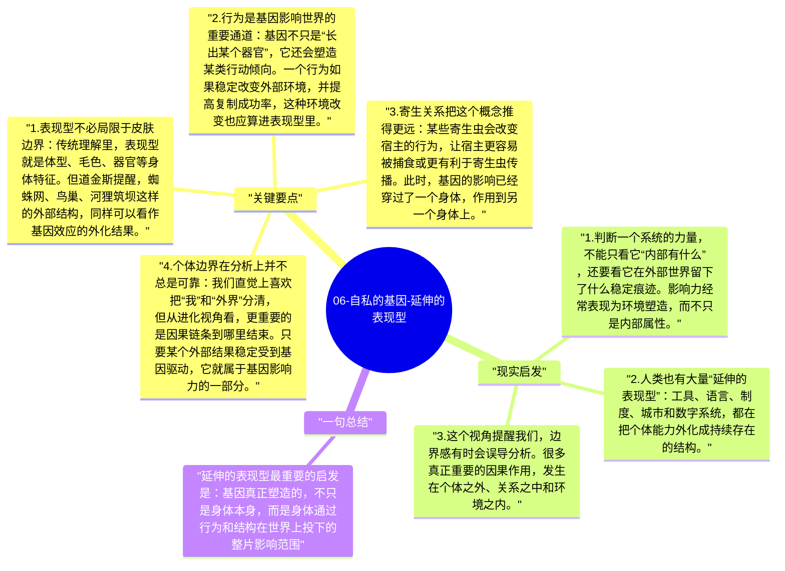

# 06-自私的基因-延伸的表现型

“延伸的表现型”是道金斯最有穿透力的概念之一。它逼着读者放弃一个过于自然的假设：基因的影响只停留在身体内部。事实上，一个基因的真正效果，往往出现在身体之外，出现在巢穴、工具、环境改造，甚至其他生物的行为变化之中。

## 关键要点

1. **表现型不必局限于皮肤边界**：传统理解里，表现型就是体型、毛色、器官等身体特征。但道金斯提醒，蜘蛛网、鸟巢、河狸筑坝这样的外部结构，同样可以看作基因效应的外化结果。
2. **行为是基因影响世界的重要通道**：基因不只是“长出某个器官”，它还会塑造某类行动倾向。一个行为如果稳定改变外部环境，并提高复制成功率，这种环境改变也应算进表现型里。
3. **寄生关系把这个概念推得更远**：某些寄生虫会改变宿主的行为，让宿主更容易被捕食或更有利于寄生虫传播。此时，基因的影响已经穿过了一个身体，作用到另一个身体上。
4. **个体边界在分析上并不总是可靠**：我们直觉上喜欢把“我”和“外界”分清，但从进化视角看，更重要的是因果链条到哪里结束。只要某个外部结果稳定受到基因驱动，它就属于基因影响力的一部分。
5. **这个概念扩展了进化解释的视野**：它让人不再只盯着生物内部，而去看生物如何改造生态位、塑造互动关系，并把环境本身变成复制策略的一部分。

## 现实启发

1. 判断一个系统的力量，不能只看它“内部有什么”，还要看它在外部世界留下了什么稳定痕迹。影响力经常表现为环境塑造，而不只是内部属性。
2. 人类也有大量“延伸的表现型”：工具、语言、制度、城市和数字系统，都在把个体能力外化成持续存在的结构。
3. 这个视角提醒我们，边界感有时会误导分析。很多真正重要的因果作用，发生在个体之外、关系之中和环境之内。

## 一句总结

延伸的表现型最重要的启发是：基因真正塑造的，不只是身体本身，而是身体通过行为和结构在世界上投下的整片影响范围。

---

## Mermaid 思维导图

### 图1

