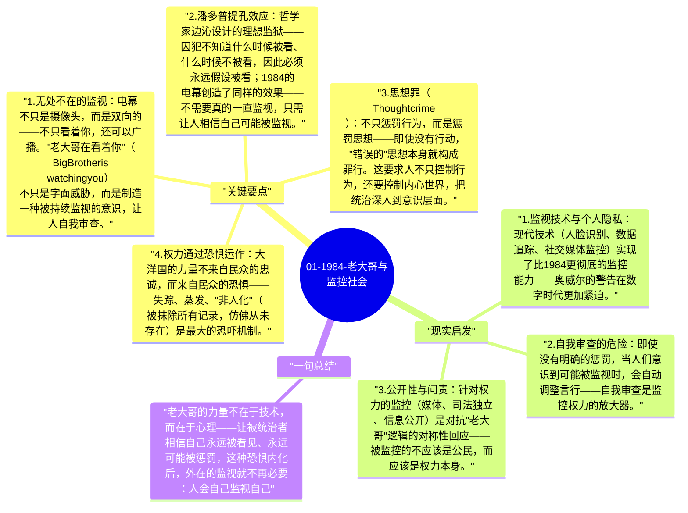

# 01-1984-老大哥与监控社会

《1984》构建的大洋国（Oceania）是一个由"老大哥"（Big Brother）主导的极权国家，电幕（telescreen）无处不在，思想警察随时监控。这不只是科幻设定，而是对极权监控逻辑的深刻分析——恐惧如何成为最有效的控制工具。

## 关键要点

1. **无处不在的监视**：电幕不只是摄像头，而是双向的——不只看着你，还可以广播。"老大哥在看着你"（Big Brother is watching you）不只是字面威胁，而是制造一种被持续监视的意识，让人自我审查。
2. **潘多普提孔效应**：哲学家边沁设计的理想监狱——囚犯不知道什么时候被看、什么时候不被看，因此必须永远假设被看；1984的电幕创造了同样的效果——不需要真的一直监视，只需让人相信自己可能被监视。
3. **思想罪（Thoughtcrime）**：不只惩罚行为，而是惩罚思想——即使没有行动，"错误的"思想本身就构成罪行。这要求人不只控制行为，还要控制内心世界，把统治深入到意识层面。
4. **权力通过恐惧运作**：大洋国的力量不来自民众的忠诚，而来自民众的恐惧——失踪、蒸发、"非人化"（被抹除所有记录，仿佛从未存在）是最大的恐吓机制。
5. **自愿的顺从**：最可怕的不是被迫顺从，而是经过长期恐惧训练后的"自愿"顺从——Winston在101室的经历揭示，人在足够大的恐惧下会主动、真诚地相信统治者希望他相信的东西。

## 现实启发

1. **监视技术与个人隐私**：现代技术（人脸识别、数据追踪、社交媒体监控）实现了比1984更彻底的监控能力——奥威尔的警告在数字时代更加紧迫。
2. **自我审查的危险**：即使没有明确的惩罚，当人们意识到可能被监视时，会自动调整言行——自我审查是监控权力的放大器。
3. **公开性与问责**：针对权力的监控（媒体、司法独立、信息公开）是对抗"老大哥"逻辑的对称性回应——被监控的不应该是公民，而应该是权力本身。

## 一句总结

老大哥的力量不在于技术，而在于心理——让被统治者相信自己永远被看见、永远可能被惩罚，这种恐惧内化后，外在的监视就不再必要：人会自己监视自己。

---

## Mermaid 思维导图

### 图1

