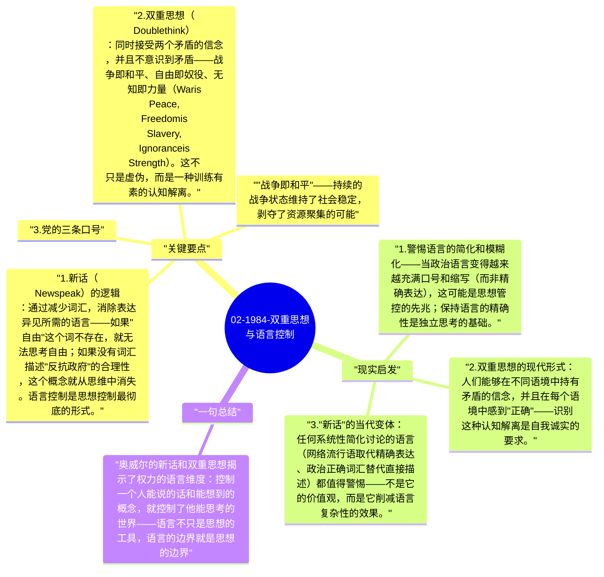

# 02-1984-双重思想与语言控制

《1984》最深刻的洞见之一：语言不只是交流工具，而是思想的边界。大洋国发明了"新话"（Newspeak）——系统性地削减词汇，最终使人在字面上无法表达异见。"双重思想"（Doublethink）则让人同时持有两个矛盾信念，并且对这个矛盾感到舒适。

## 关键要点

1. **新话（Newspeak）的逻辑**：通过减少词汇，消除表达异见所需的语言——如果"自由"这个词不存在，就无法思考自由；如果没有词汇描述"反抗政府"的合理性，这个概念就从思维中消失。语言控制是思想控制最彻底的形式。
2. **双重思想（Doublethink）**：同时接受两个矛盾的信念，并且不意识到矛盾——战争即和平、自由即奴役、无知即力量（War is Peace, Freedom is Slavery, Ignorance is Strength）。这不只是虚伪，而是一种训练有素的认知解离。
3. **党的三条口号**：
   - "战争即和平"——持续的战争状态维持了社会稳定，剥夺了资源聚集的可能
   - "自由即奴役"——真正的自由（独立于集体）实际上使人软弱
   - "无知即力量"——无知的民众更容易控制；知识分子是危险的
4. **语言简化与批判性思维的关系**：维特根斯坦说"我的语言的边界是我的世界的边界"——当语言变得贫乏，可以思考的概念就变得贫乏；鼓励语言复杂性和精确性，是对抗思想简化的重要手段。
5. **真理部（Ministry of Truth）**：负责不断重写历史，使"现在正确的"与"过去发生的"一致——历史的流动性使任何固定的"事实"都不可信，这创造了一个没有客观参照点的世界。

## 现实启发

1. 警惕语言的简化和模糊化——当政治语言变得越来越充满口号和缩写（而非精确表达），这可能是思想管控的先兆；保持语言的精确性是独立思考的基础。
2. 双重思想的现代形式：人们能够在不同语境中持有矛盾的信念，并且在每个语境中感到"正确"——识别这种认知解离是自我诚实的要求。
3. "新话"的当代变体：任何系统性简化讨论的语言（网络流行语取代精确表达、政治正确词汇替代直接描述）都值得警惕——不是它的价值观，而是它削减语言复杂性的效果。

## 一句总结

奥威尔的新话和双重思想揭示了权力的语言维度：控制一个人能说的话和能想到的概念，就控制了他能思考的世界——语言不只是思想的工具，语言的边界就是思想的边界。

---

## Mermaid 思维导图

### 图1

