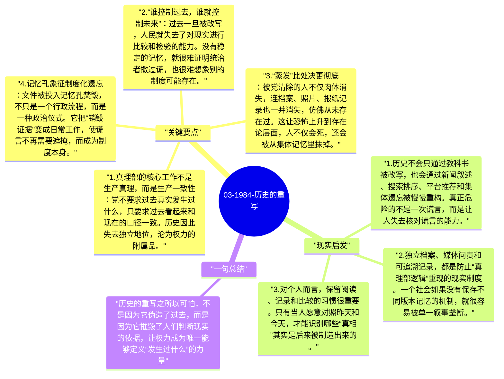

# 03-1984-历史的重写

《1984》中最令人不安的设定之一，不是监控，也不是酷刑，而是对过去的持续篡改。Winston 在真理部的工作，就是不断把旧报纸、旧讲话、旧统计改写成符合当下政治需要的新版本。奥威尔借此指出：如果一个政权可以任意改写过去，那么它就不仅控制了信息，也控制了人们判断现实的坐标。

## 关键要点

1. **真理部的核心工作不是生产真理，而是生产一致性**：党不要求过去真实发生过什么，只要求过去看起来和现在的口径一致。历史因此失去独立地位，沦为权力的附属品。
2. **“谁控制过去，谁就控制未来”**：过去一旦被改写，人民就失去了对现实进行比较和检验的能力。没有稳定的记忆，就很难证明统治者撒过谎，也很难想象别的制度可能存在。
3. **“蒸发”比处决更彻底**：被党清除的人不仅肉体消失，连档案、照片、报纸记录也一并消失，仿佛从未存在过。这让恐怖上升到存在论层面，人不仅会死，还会被从集体记忆里抹掉。
4. **记忆孔象征制度化遗忘**：文件被投入记忆孔焚毁，不只是一个行政流程，而是一种政治仪式。它把“销毁证据”变成日常工作，使谎言不再需要遮掩，而成为制度本身。
5. **个人记忆是最后的抵抗阵地**：Winston 之所以危险，不在于他做了什么大事，而在于他隐约记得“事情并非一直如此”。在一个一切可被改写的世界里，模糊但真实的记忆本身就是反抗。

## 现实启发

1. 历史不会只通过教科书被改写，也会通过新闻叙述、搜索排序、平台推荐和集体遗忘被慢慢重构。真正危险的不是一次谎言，而是让人失去核对谎言的能力。
2. 独立档案、媒体问责和可追溯记录，都是防止“真理部逻辑”重现的现实制度。一个社会如果没有保存不同版本记忆的机制，就很容易被单一叙事垄断。
3. 对个人而言，保留阅读、记录和比较的习惯很重要。只有当人愿意对照昨天和今天，才能识别哪些“真相”其实是后来被制造出来的。

## 一句总结

历史的重写之所以可怕，不是因为它伪造了过去，而是因为它摧毁了人们判断现实的依据，让权力成为唯一能够定义“发生过什么”的力量。

---

## Mermaid 思维导图

### 图1

