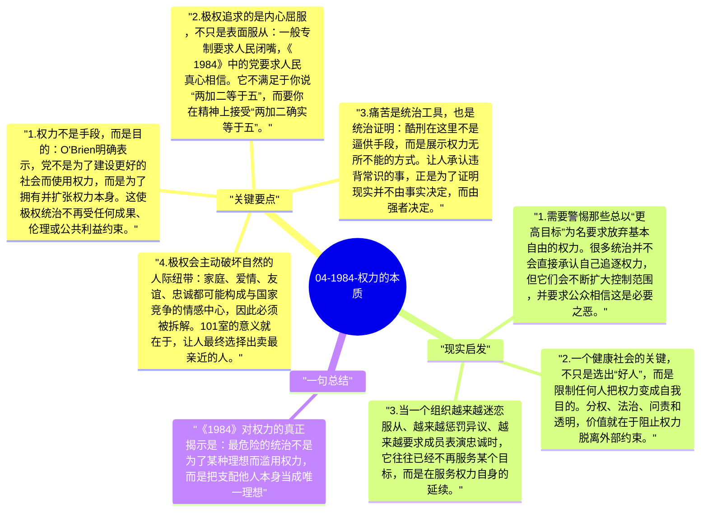

# 04-1984-权力的本质

《1984》最尖锐的部分，集中在 O'Brien 对 Winston 的那段解释：党并不为了幸福、秩序或乌托邦而掌权，权力本身就是目的。奥威尔在这里剥掉了政治宣传的外衣，把极权主义的终极逻辑直接说透了：真正危险的权力，不需要外在理由，它只需要不断证明自己能够支配人的身体和灵魂。

## 关键要点

1. **权力不是手段，而是目的**：O'Brien 明确表示，党不是为了建设更好的社会而使用权力，而是为了拥有并扩张权力本身。这使极权统治不再受任何成果、伦理或公共利益约束。
2. **极权追求的是内心屈服，不只是表面服从**：一般专制要求人民闭嘴，《1984》中的党要求人民真心相信。它不满足于你说“两加二等于五”，而要你在精神上接受“两加二确实等于五”。
3. **痛苦是统治工具，也是统治证明**：酷刑在这里不是逼供手段，而是展示权力无所不能的方式。让人承认违背常识的事，正是为了证明现实并不由事实决定，而由强者决定。
4. **极权会主动破坏自然的人际纽带**：家庭、爱情、友谊、忠诚都可能构成与国家竞争的情感中心，因此必须被拆解。101室的意义就在于，让人最终选择出卖最亲近的人。
5. **永久战争与永久敌人是权力自我维持的机制**：如果社会始终处在紧急状态，人民就更容易接受匮乏、监视和服从。战争的目标不一定是胜利，而是维持一个需要高度控制的政治环境。

## 现实启发

1. 需要警惕那些总以“更高目标”为名要求放弃基本自由的权力。很多统治并不会直接承认自己追逐权力，但它们会不断扩大控制范围，并要求公众相信这是必要之恶。
2. 一个健康社会的关键，不只是选出“好人”，而是限制任何人把权力变成自我目的。分权、法治、问责和透明，价值就在于阻止权力脱离外部约束。
3. 当一个组织越来越迷恋服从、越来越惩罚异议、越来越要求成员表演忠诚时，它往往已经不再服务某个目标，而是在服务权力自身的延续。

## 一句总结

《1984》对权力的真正揭示是：最危险的统治不是为了某种理想而滥用权力，而是把支配他人本身当成唯一理想。

---

## Mermaid 思维导图

### 图1

