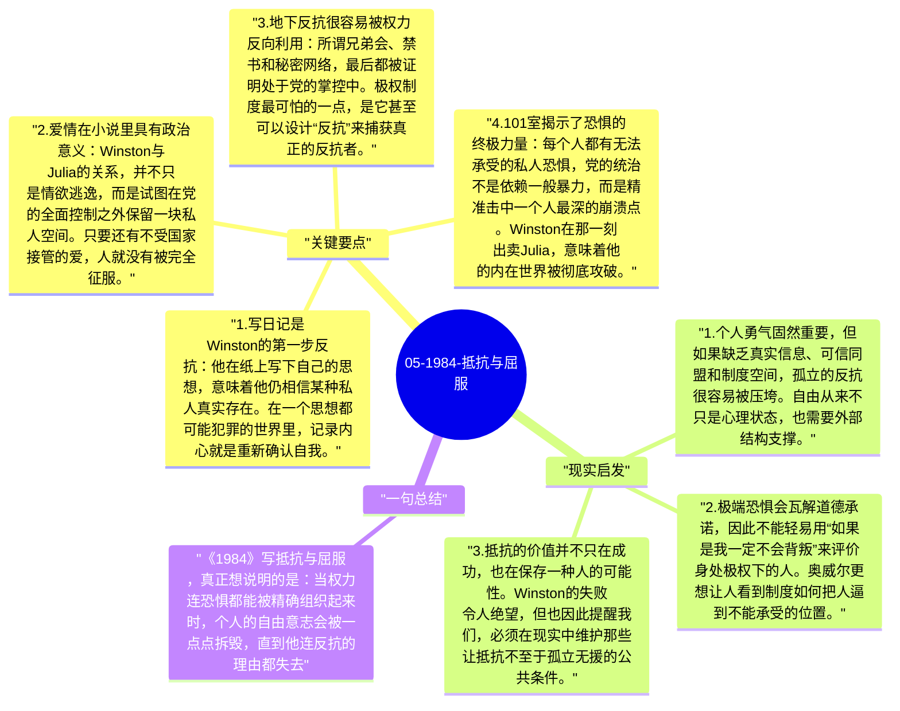

# 05-1984-抵抗与屈服

Winston 的故事之所以悲惨，不在于他一开始就软弱，而在于他确实尝试过抵抗。他写日记、与 Julia 相爱、憎恨党、向往真实，这些都构成了一个人对极权秩序最本能的反抗。但奥威尔最终让他失败，正是为了说明：当权力能够全面控制恐惧、信息和身体时，个人的抵抗会变得多么脆弱。

## 关键要点

1. **写日记是 Winston 的第一步反抗**：他在纸上写下自己的思想，意味着他仍相信某种私人真实存在。在一个思想都可能犯罪的世界里，记录内心就是重新确认自我。
2. **爱情在小说里具有政治意义**：Winston 与 Julia 的关系，并不只是情欲逃逸，而是试图在党的全面控制之外保留一块私人空间。只要还有不受国家接管的爱，人就没有被完全征服。
3. **地下反抗很容易被权力反向利用**：所谓兄弟会、禁书和秘密网络，最后都被证明处于党的掌控中。极权制度最可怕的一点，是它甚至可以设计“反抗”来捕获真正的反抗者。
4. **101室揭示了恐惧的终极力量**：每个人都有无法承受的私人恐惧，党的统治不是依赖一般暴力，而是精准击中一个人最深的崩溃点。Winston 在那一刻出卖 Julia，意味着他的内在世界被彻底攻破。
5. **屈服的完成是主动热爱老大哥**：结尾最残酷之处不在于 Winston 活下来，而在于他真心爱上了老大哥。权力的胜利不只是镇压了反对者，而是把反对者改造成支持者。

## 现实启发

1. 个人勇气固然重要，但如果缺乏真实信息、可信同盟和制度空间，孤立的反抗很容易被压垮。自由从来不只是心理状态，也需要外部结构支撑。
2. 极端恐惧会瓦解道德承诺，因此不能轻易用“如果是我一定不会背叛”来评价身处极权下的人。奥威尔更想让人看到制度如何把人逼到不能承受的位置。
3. 抵抗的价值并不只在成功，也在保存一种人的可能性。Winston 的失败令人绝望，但也因此提醒我们，必须在现实中维护那些让抵抗不至于孤立无援的公共条件。

## 一句总结

《1984》写抵抗与屈服，真正想说明的是：当权力连恐惧都能被精确组织起来时，个人的自由意志会被一点点拆毁，直到他连反抗的理由都失去。

---

## Mermaid 思维导图

### 图1

