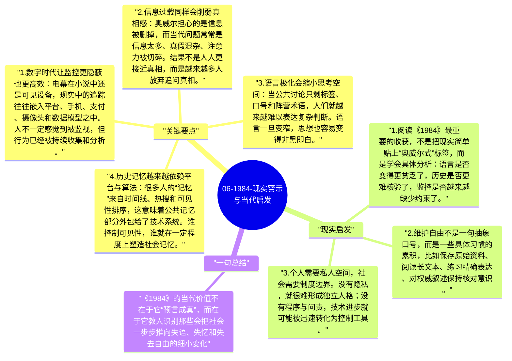

# 06-1984-现实警示与当代启发

《1984》之所以不断被重读，不是因为现实世界已经完全变成了大洋国，而是因为它提供了一套识别危险趋势的分析工具。奥威尔关心的并非某种具体制度的复制品，而是任何社会一旦出现监控扩张、语言贫乏、历史操控和恐惧政治时，人的自由会如何被侵蚀。

## 关键要点

1. **数字时代让监控更隐蔽也更高效**：电幕在小说中还是可见设备，现实中的追踪往往嵌入平台、手机、支付、摄像头和数据模型之中。人不一定感觉到被监视，但行为已经被持续收集和分析。
2. **信息过载同样会削弱真相感**：奥威尔担心的是信息被删掉，而当代问题常常是信息太多、真假混杂、注意力被切碎。结果不是人人更接近真相，而是越来越多人放弃追问真相。
3. **语言极化会缩小思考空间**：当公共讨论只剩标签、口号和阵营术语，人们就越来越难以表达复杂判断。语言一旦变窄，思想也容易变得非黑即白。
4. **历史记忆越来越依赖平台与算法**：很多人的“记忆”来自时间线、热搜和可见性排序，这意味着公共记忆部分外包给了技术系统。谁控制可见性，谁就在一定程度上塑造社会记忆。
5. **恐惧政治依然有效**：无论是外敌叙事、治安焦虑还是道德恐慌，只要社会长期处在“必须立刻服从”的情绪里，个体就更容易放弃程序、规则和自由，以换取一种想象中的安全。

## 现实启发

1. 阅读《1984》最重要的收获，不是把现实简单贴上“奥威尔式”标签，而是学会具体分析：语言是否变得更贫乏了，历史是否更难核验了，监控是否越来越缺少约束了。
2. 维护自由不是一句抽象口号，而是一些具体习惯的累积，比如保存原始资料、阅读长文本、练习精确表达、对权威叙述保持核对意识。
3. 个人需要私人空间，社会需要制度边界。没有隐私，就很难形成独立人格；没有程序与问责，技术进步就可能被迅速转化为控制工具。

## 一句总结

《1984》的当代价值不在于它“预言成真”，而在于它教人识别那些会把社会一步步推向失语、失忆和失去自由的细小变化。

---

## Mermaid 思维导图

### 图1

