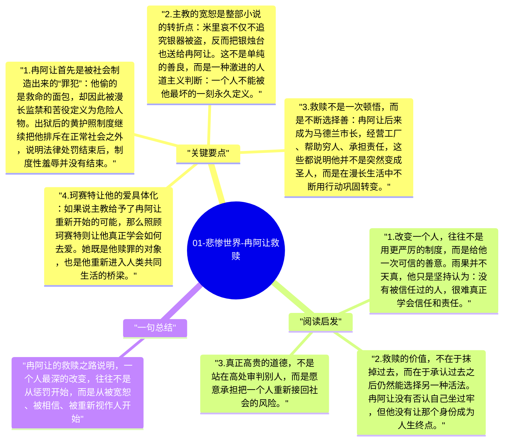

# 01-悲惨世界-冉阿让救赎

冉阿让是《悲惨世界》的核心人物，也是雨果“人可以被重新塑造”这一信念最完整的承载者。他因偷面包入狱，出狱后被社会持续排斥，本来已经被制度推向仇恨与报复；但米里哀主教的一次宽恕，改变了他后半生的轨迹。雨果通过他告诉读者，真正改变一个人的，不是惩罚的强度，而是被重新当作人来对待的那一刻。

## 关键要点

1. **冉阿让首先是被社会制造出来的“罪犯”**：他偷的是救命的面包，却因此被漫长监禁和苦役定义为危险人物。出狱后的黄护照制度继续把他排斥在正常社会之外，说明法律处罚结束后，制度性羞辱并没有结束。
2. **主教的宽恕是整部小说的转折点**：米里哀不仅不追究银器被盗，反而把银烛台也送给冉阿让。这不是单纯的善良，而是一种激进的人道主义判断：一个人不能被他最坏的一刻永久定义。
3. **救赎不是一次顿悟，而是不断选择善**：冉阿让后来成为马德兰市长，经营工厂、帮助穷人、承担责任，这些都说明他并不是突然变成圣人，而是在漫长生活中不断用行动巩固转变。
4. **珂赛特让他的爱具体化**：如果说主教给予了冉阿让重新开始的可能，那么照顾珂赛特则让他真正学会如何去爱。她既是他赎罪的对象，也是他重新进入人类共同生活的桥梁。
5. **救赎的完成体现在放下自我占有**：到了后半部，冉阿让愿意成全珂赛特与马吕斯，也愿意在必要时退出她的新生活。真正的爱不再是抓住，而是把对方送向更广阔的人生。

## 阅读启发

1. 改变一个人，往往不是用更严厉的制度，而是给他一次可信的善意。雨果并不天真，他只是坚持认为：没有被信任过的人，很难真正学会信任和责任。
2. 救赎的价值，不在于抹掉过去，而在于承认过去之后仍然能选择另一种活法。冉阿让没有否认自己坐过牢，但他没有让那个身份成为人生终点。
3. 真正高贵的道德，不是站在高处审判别人，而是愿意承担把一个人重新接回社会的风险。

## 一句总结

冉阿让的救赎之路说明，一个人最深的改变，往往不是从惩罚开始，而是从被宽恕、被相信、被重新视作人开始。

---

## Mermaid 思维导图

### 图1

