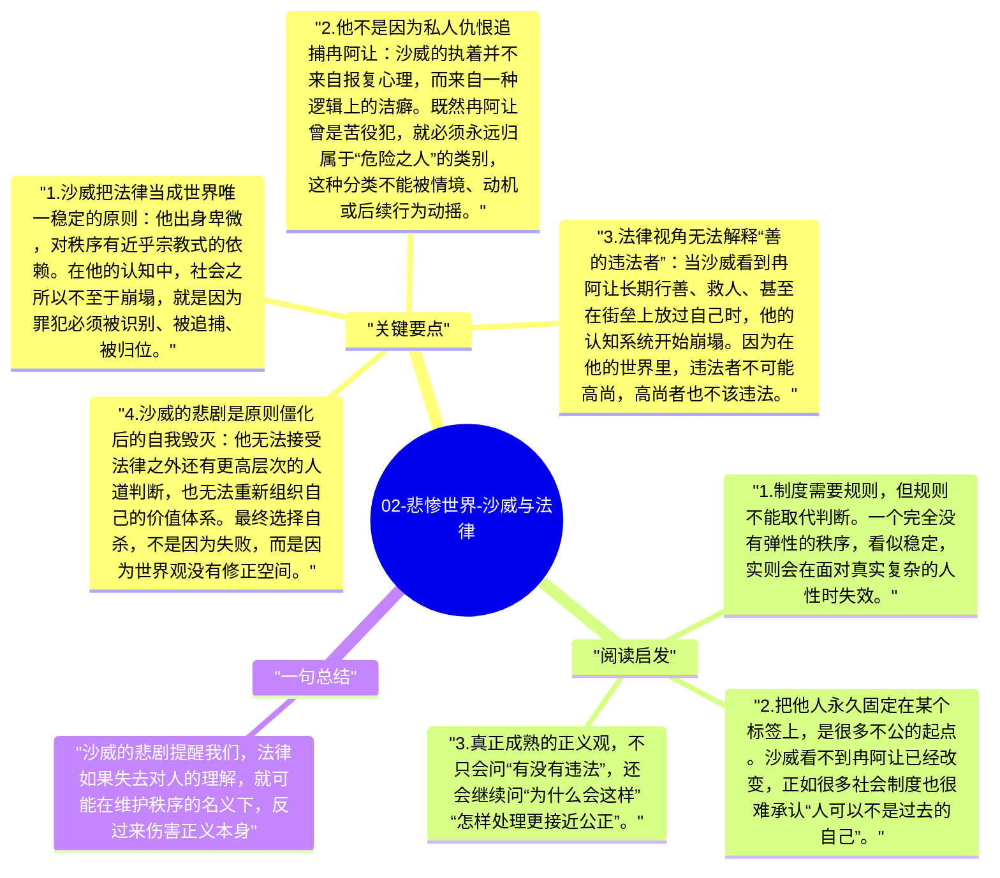

# 02-悲惨世界-沙威与法律

沙威是《悲惨世界》中最复杂的角色之一，因为他并不是单纯的恶人。他勤勉、克制、忠于职责，也真心相信自己是在维护秩序。雨果借他提出一个尖锐问题：当法律被绝对化、程序被神圣化，而人被压缩成案件和身份标签时，正义会不会反而变成另一种不义？

## 关键要点

1. **沙威把法律当成世界唯一稳定的原则**：他出身卑微，对秩序有近乎宗教式的依赖。在他的认知中，社会之所以不至于崩塌，就是因为罪犯必须被识别、被追捕、被归位。
2. **他不是因为私人仇恨追捕冉阿让**：沙威的执着并不来自报复心理，而来自一种逻辑上的洁癖。既然冉阿让曾是苦役犯，就必须永远归属于“危险之人”的类别，这种分类不能被情境、动机或后续行为动摇。
3. **法律视角无法解释“善的违法者”**：当沙威看到冉阿让长期行善、救人、甚至在街垒上放过自己时，他的认知系统开始崩塌。因为在他的世界里，违法者不可能高尚，高尚者也不该违法。
4. **沙威的悲剧是原则僵化后的自我毁灭**：他无法接受法律之外还有更高层次的人道判断，也无法重新组织自己的价值体系。最终选择自杀，不是因为失败，而是因为世界观没有修正空间。
5. **雨果并不是反对法律，而是反对法律失去目的**：法律本应服务于公正、保护弱者、维持共同生活；一旦法律本身成为终点，它就可能压倒人性，甚至与正义背离。

## 阅读启发

1. 制度需要规则，但规则不能取代判断。一个完全没有弹性的秩序，看似稳定，实则会在面对真实复杂的人性时失效。
2. 把他人永久固定在某个标签上，是很多不公的起点。沙威看不到冉阿让已经改变，正如很多社会制度也很难承认“人可以不是过去的自己”。
3. 真正成熟的正义观，不只会问“有没有违法”，还会继续问“为什么会这样”“怎样处理更接近公正”。

## 一句总结

沙威的悲剧提醒我们，法律如果失去对人的理解，就可能在维护秩序的名义下，反过来伤害正义本身。

---

## Mermaid 思维导图

### 图1

