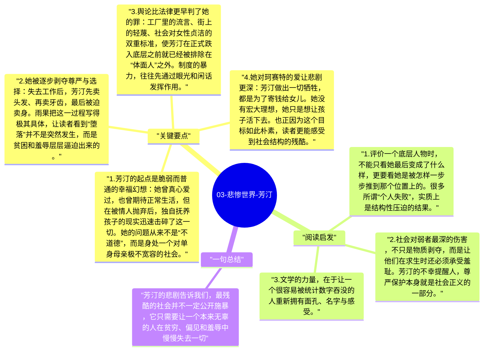

# 03-悲惨世界-芳汀

芳汀是《悲惨世界》中最令人心碎的角色之一，因为她的悲剧几乎没有任何戏剧化的“个人罪过”，却一步一步被社会推向绝境。雨果借她展示的不是单个坏人的残忍，而是一整套对贫穷女性极其严酷的制度与舆论结构。她的堕落，并非道德失败，而是社会冷漠的结果。

## 关键要点

1. **芳汀的起点是脆弱而普通的幸福幻想**：她曾真心爱过，也曾期待正常生活，但在被情人抛弃后，独自抚养孩子的现实迅速击碎了这一切。她的问题从来不是“不道德”，而是身处一个对单身母亲极不宽容的社会。
2. **她被逐步剥夺尊严与选择**：失去工作后，芳汀先卖头发、再卖牙齿，最后被迫卖身。雨果把这一过程写得极其具体，让读者看到“堕落”并不是突然发生，而是贫困和羞辱层层逼迫出来的。
3. **舆论比法律更早判了她的罪**：工厂里的流言、街上的轻蔑、社会对女性贞洁的双重标准，使芳汀在正式跌入底层之前就已经被排除在“体面人”之外。制度的暴力，往往先通过眼光和闲话发挥作用。
4. **她对珂赛特的爱让悲剧更深**：芳汀做出一切牺牲，都是为了寄钱给女儿。她没有宏大理想，她只是想让孩子活下去。也正因为这个目标如此朴素，读者更能感受到社会结构的残酷。
5. **芳汀之死是一种控诉**：她直到临终都没能真正从压迫中脱身。雨果不是把她写成道德教材，而是把她写成一个证据，证明所谓文明社会完全可能在表面秩序之下持续制造悲剧。

## 阅读启发

1. 评价一个底层人物时，不能只看她最后变成了什么样，更要看她是被怎样一步步推到那个位置上的。很多所谓“个人失败”，实质上是结构性压迫的结果。
2. 社会对弱者最深的伤害，不只是物质剥夺，而是让他们在求生时还必须承受羞耻。芳汀的不幸提醒人，尊严保护本身就是社会正义的一部分。
3. 文学的力量，在于让一个很容易被统计数字吞没的人重新拥有面孔、名字与感受。

## 一句总结

芳汀的悲剧告诉我们，最残酷的社会并不一定公开施暴，它只需要让一个本来无辜的人在贫穷、偏见和羞辱中慢慢失去一切。

---

## Mermaid 思维导图

### 图1

