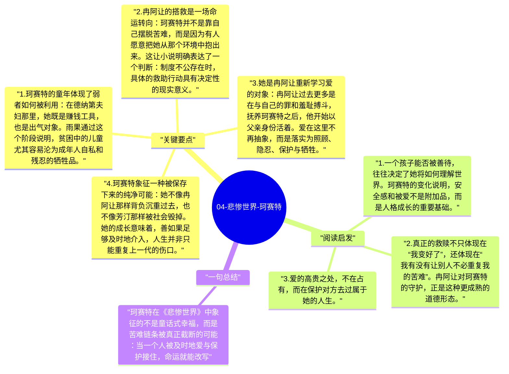

# 04-悲惨世界-珂赛特

与芳汀的悲剧相比，珂赛特在《悲惨世界》中代表的是另一条线索：爱是否真的能够打断苦难的传递。她从德纳第夫妇家里受虐待的小女孩，成长为被珍惜、被保护、被认真对待的年轻女性。她的存在，让冉阿让的救赎不再只是自我净化，而是变成了对下一代命运的实际改变。

## 关键要点

1. **珂赛特的童年体现了弱者如何被利用**：在德纳第夫妇那里，她既是赚钱工具，也是出气对象。雨果通过这个阶段说明，贫困中的儿童尤其容易沦为成年人自私和残忍的牺牲品。
2. **冉阿让的搭救是一场命运转向**：珂赛特并不是靠自己摆脱苦难，而是因为有人愿意把她从那个环境中抱出来。这让小说明确表达了一个判断：制度不公存在时，具体的救助行动具有决定性的现实意义。
3. **她是冉阿让重新学习爱的对象**：冉阿让过去更多是在与自己的罪和羞耻搏斗，抚养珂赛特之后，他开始以父亲身份活着。爱在这里不再抽象，而是落实为照顾、隐忍、保护与牺牲。
4. **珂赛特象征一种被保存下来的纯净可能**：她不像冉阿让那样背负沉重过去，也不像芳汀那样被社会毁掉。她的成长意味着，善如果足够及时地介入，人生并非只能重复上一代的伤口。
5. **她与马吕斯的爱情让冉阿让学会放手**：小说后段最动人的部分之一，不是相爱本身，而是冉阿让如何在爱与失去之间完成最后一次道德成长。他没有把珂赛特据为己有，而是愿意接受她拥有自己的生活。

## 阅读启发

1. 一个孩子能否被善待，往往决定了她将如何理解世界。珂赛特的变化说明，安全感和被爱不是附加品，而是人格成长的重要基础。
2. 真正的救赎不只体现在“我变好了”，还体现在“我有没有让别人不必重复我的苦难”。冉阿让对珂赛特的守护，正是这种更成熟的道德形态。
3. 爱的高贵之处，不在占有，而在保护对方去过属于她的人生。

## 一句总结

珂赛特在《悲惨世界》中象征的不是童话式幸福，而是苦难链条被真正截断的可能：当一个人被及时地爱与保护接住，命运就能改写。

---

## Mermaid 思维导图

### 图1

