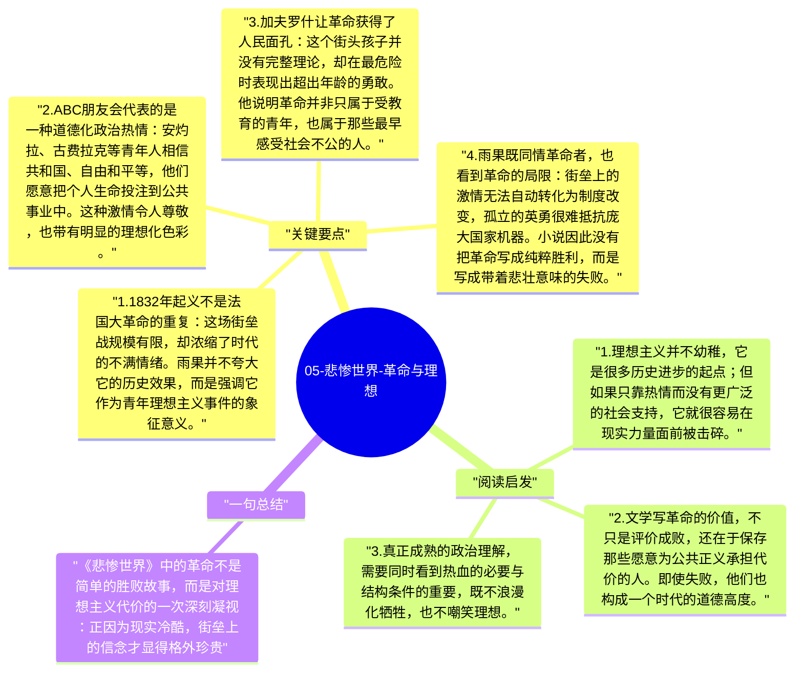

# 05-悲惨世界-革命与理想

很多读者因为音乐剧而记住《悲惨世界》的街垒场景，但雨果写这部分，并不只是为了渲染英雄主义。他借 1832 年巴黎起义，把青年理想、政治失败、普通人的勇气和历史的冷酷放在一起，让读者看到：革命既有壮烈的一面，也有无力的一面；它既是道德激情的爆发，也可能因为缺乏现实基础而迅速失败。

## 关键要点

1. **1832 年起义不是法国大革命的重复**：这场街垒战规模有限，却浓缩了时代的不满情绪。雨果并不夸大它的历史效果，而是强调它作为青年理想主义事件的象征意义。
2. **ABC 朋友会代表的是一种道德化政治热情**：安灼拉、古费拉克等青年人相信共和国、自由和平等，他们愿意把个人生命投注到公共事业中。这种激情令人尊敬，也带有明显的理想化色彩。
3. **加夫罗什让革命获得了人民面孔**：这个街头孩子并没有完整理论，却在最危险时表现出超出年龄的勇敢。他说明革命并非只属于受教育的青年，也属于那些最早感受社会不公的人。
4. **雨果既同情革命者，也看到革命的局限**：街垒上的激情无法自动转化为制度改变，孤立的英勇很难抵抗庞大国家机器。小说因此没有把革命写成纯粹胜利，而是写成带着悲壮意味的失败。
5. **革命段落也推动了人物成长**：马吕斯在街垒上经历爱情、责任和死亡的接近；冉阿让则在这里完成对年轻一代的成全。政治事件因此与私人命运紧密交织。

## 阅读启发

1. 理想主义并不幼稚，它是很多历史进步的起点；但如果只靠热情而没有更广泛的社会支持，它就很容易在现实力量面前被击碎。
2. 文学写革命的价值，不只是评价成败，还在于保存那些愿意为公共正义承担代价的人。即使失败，他们也构成一个时代的道德高度。
3. 真正成熟的政治理解，需要同时看到热血的必要与结构条件的重要，既不浪漫化牺牲，也不嘲笑理想。

## 一句总结

《悲惨世界》中的革命不是简单的胜败故事，而是对理想主义代价的一次深刻凝视：正因为现实冷酷，街垒上的信念才显得格外珍贵。

---

## Mermaid 思维导图

### 图1

