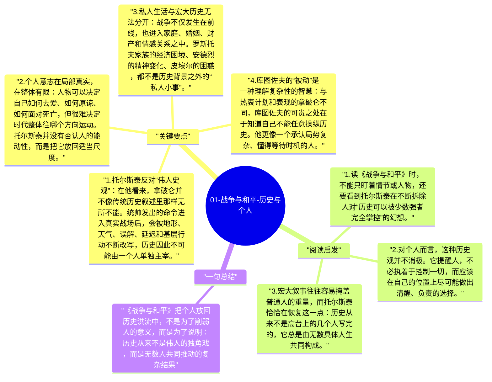

# 01-战争与和平-历史与个人

《战争与和平》虽然写的是拿破仑战争，但托尔斯泰真正关心的问题并不是哪一场战役赢了，而是历史究竟由谁推动。是伟人的决断、统帅的命令，还是无数普通人的行动、误差与偶然性交织出来的结果？他通过小说不断削弱“英雄创造历史”的想象，把个人命运放进更巨大的历史洪流里重新衡量。

## 关键要点

1. **托尔斯泰反对“伟人史观”**：在他看来，拿破仑并不像传统历史叙述里那样无所不能。统帅发出的命令进入真实战场后，会被地形、天气、误解、延迟和基层行动不断改写，历史因此不可能由一个人单独主宰。
2. **个人意志在局部真实，在整体有限**：人物可以决定自己如何去爱、如何原谅、如何面对死亡，但很难决定时代整体往哪个方向运动。托尔斯泰并没有否认人的能动性，而是把它放回适当尺度。
3. **私人生活与宏大历史无法分开**：战争不仅发生在前线，也进入家庭、婚姻、财产和情感关系之中。罗斯托夫家族的经济困境、安德烈的精神变化、皮埃尔的困惑，都不是历史背景之外的“私人小事”。
4. **库图佐夫的“被动”是一种理解复杂性的智慧**：与热衷计划和表现的拿破仑不同，库图佐夫的可贵之处在于知道自己不能任意操纵历史。他更像一个承认局势复杂、懂得等待时机的人。
5. **历史是涌现，不是剧本**：真正推动历史的，是数不清的个人选择、集体情绪、物资条件和偶然事件的叠加。托尔斯泰用小说形式提前表达了一种现代复杂系统的直觉。

## 阅读启发

1. 读《战争与和平》时，不能只盯着情节或人物，还要看到托尔斯泰在不断拆除人对“历史可以被少数强者完全掌控”的幻想。
2. 对个人而言，这种历史观并不消极。它提醒人，不必执着于控制一切，而应该在自己的位置上尽可能做出清醒、负责的选择。
3. 宏大叙事往往容易掩盖普通人的重量，而托尔斯泰恰恰在恢复这一点：历史从来不是高台上的几个人写完的，它总是由无数具体人生共同构成。

## 一句总结

《战争与和平》把个人放回历史洪流中，不是为了削弱人的意义，而是为了说明：历史从来不是伟人的独角戏，而是无数人共同推动的复杂结果。

---

## Mermaid 思维导图

### 图1

