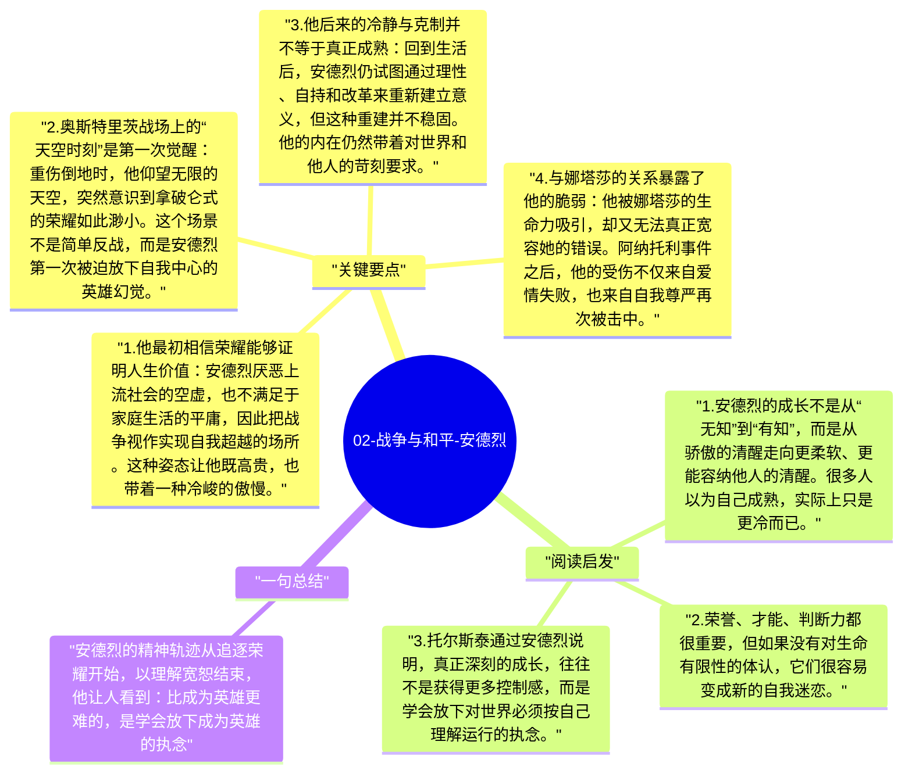

# 02-战争与和平-安德烈

安德烈·博尔孔斯基是《战争与和平》中最具有“精神高度”的人物之一。他一开始追求荣誉、厌倦俗世，希望在战争与功业中找到高于日常生活的意义；但随着理想破灭、亲人离去、爱情受挫和死亡逼近，他逐渐发现，真正重要的并不是名声，而是对他人的理解、宽恕与内心的平静。

## 关键要点

1. **他最初相信荣耀能够证明人生价值**：安德烈厌恶上流社会的空虚，也不满足于家庭生活的平庸，因此把战争视作实现自我超越的场所。这种姿态让他既高贵，也带着一种冷峻的傲慢。
2. **奥斯特里茨战场上的“天空时刻”是第一次觉醒**：重伤倒地时，他仰望无限的天空，突然意识到拿破仑式的荣耀如此渺小。这个场景不是简单反战，而是安德烈第一次被迫放下自我中心的英雄幻觉。
3. **他后来的冷静与克制并不等于真正成熟**：回到生活后，安德烈仍试图通过理性、自持和改革来重新建立意义，但这种重建并不稳固。他的内在仍然带着对世界和他人的苛刻要求。
4. **与娜塔莎的关系暴露了他的脆弱**：他被娜塔莎的生命力吸引，却又无法真正宽容她的错误。阿纳托利事件之后，他的受伤不仅来自爱情失败，也来自自我尊严再次被击中。
5. **临终前的宽恕完成了他的精神成长**：战争中再次受伤后，安德烈逐渐走向一种更深的平和。他不再执着于评判，而是开始理解爱与宽恕比荣誉更接近生命真相。

## 阅读启发

1. 安德烈的成长不是从“无知”到“有知”，而是从骄傲的清醒走向更柔软、更能容纳他人的清醒。很多人以为自己成熟，实际上只是更冷而已。
2. 荣誉、才能、判断力都很重要，但如果没有对生命有限性的体认，它们很容易变成新的自我迷恋。
3. 托尔斯泰通过安德烈说明，真正深刻的成长，往往不是获得更多控制感，而是学会放下对世界必须按自己理解运行的执念。

## 一句总结

安德烈的精神轨迹从追逐荣耀开始，以理解宽恕结束，他让人看到：比成为英雄更难的，是学会放下成为英雄的执念。

---

## Mermaid 思维导图

### 图1

