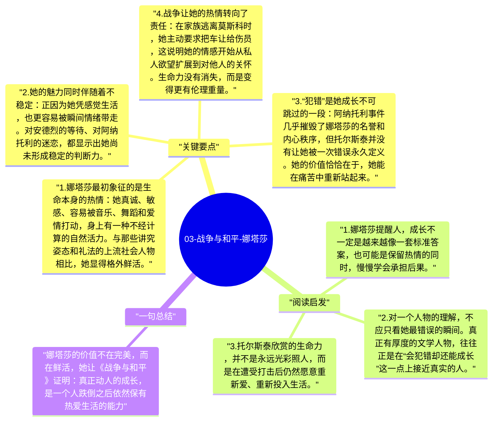

# 03-战争与和平-娜塔莎

娜塔莎·罗斯托娃是《战争与和平》中最有生命力的角色。她并不以理性见长，也不代表某种稳定的道德原则，但她身上有一种直接感受生活、迅速回应世界的能力。托尔斯泰通过她展示了另一种成长路径：人可以因为冲动而犯错，也可以在错误、痛苦和现实磨砺中逐渐变得更深、更真实。

## 关键要点

1. **娜塔莎最初象征的是生命本身的热情**：她真诚、敏感、容易被音乐、舞蹈和爱情打动，身上有一种不经计算的自然活力。与那些讲究姿态和礼法的上流社会人物相比，她显得格外鲜活。
2. **她的魅力同时伴随着不稳定**：正因为她凭感觉生活，也更容易被瞬间情绪带走。对安德烈的等待、对阿纳托利的迷恋，都显示出她尚未形成稳定的判断力。
3. **“犯错”是她成长不可跳过的一段**：阿纳托利事件几乎摧毁了娜塔莎的名誉和内心秩序，但托尔斯泰并没有让她被一次错误永久定义。她的价值恰恰在于，她能在痛苦中重新站起来。
4. **战争让她的热情转向了责任**：在家族逃离莫斯科时，她主动要求把车让给伤员，这说明她的情感开始从私人欲望扩展到对他人的关怀。生命力没有消失，而是变得更有伦理重量。
5. **她后来的平凡生活不是简单退场**：很多读者会为娜塔莎最终回归家庭而遗憾，但托尔斯泰想写的不是传奇女主角，而是一个人在经历巨大震荡之后，如何在具体生活中安放自己。

## 阅读启发

1. 娜塔莎提醒人，成长不一定是越来越像一套标准答案，也可能是保留热情的同时，慢慢学会承担后果。
2. 对一个人物的理解，不应只看她最错误的瞬间。真正有厚度的文学人物，往往正是在“会犯错却还能成长”这一点上接近真实的人。
3. 托尔斯泰欣赏的生命力，并不是永远光彩照人，而是在遭受打击后仍然愿意重新爱、重新投入生活。

## 一句总结

娜塔莎的价值不在完美，而在鲜活，她让《战争与和平》证明：真正动人的成长，是一个人跌倒之后依然保有热爱生活的能力。

---

## Mermaid 思维导图

### 图1

