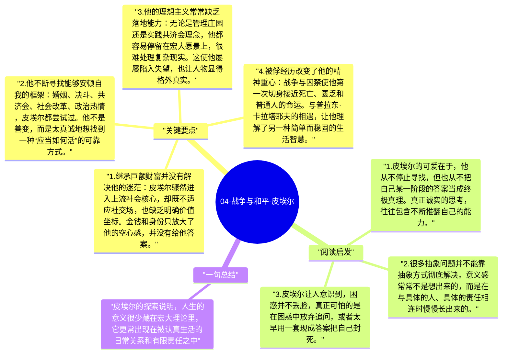

# 04-战争与和平-皮埃尔

皮埃尔·别祖霍夫是《战争与和平》中最典型的“寻找意义的人”。他有财富、有地位、有受教育背景，却始终不知道怎样生活才算正确。托尔斯泰把许多哲学性问题都放进了皮埃尔身上：人为什么空虚？知识和道德是什么关系？真正的幸福来自哪里？他的可贵之处，在于他始终愿意修正自己，哪怕一次次走错路。

## 关键要点

1. **继承巨额财富并没有解决他的迷茫**：皮埃尔骤然进入上流社会核心，却既不适应社交场，也缺乏明确价值坐标。金钱和身份只放大了他的空心感，并没有给他答案。
2. **他不断寻找能够安顿自我的框架**：婚姻、决斗、共济会、社会改革、政治热情，皮埃尔都尝试过。他不是善变，而是太真诚地想找到一种“应当如何活”的可靠方式。
3. **他的理想主义常常缺乏落地能力**：无论是管理庄园还是实践共济会理念，他都容易停留在宏大愿景上，很难处理复杂现实。这使他屡屡陷入失望，也让人物显得格外真实。
4. **被俘经历改变了他的精神重心**：战争与囚禁使他第一次切身接近死亡、匮乏和普通人的命运。与普拉东·卡拉塔耶夫的相遇，让他理解了另一种简单而稳固的生活智慧。
5. **他最终找到的不是宏大理论，而是具体生活**：回到日常之后，皮埃尔并没有变成“什么都想明白”的哲学家，而是学会在爱、家庭、责任和有限的行动中安顿自己。

## 阅读启发

1. 皮埃尔的可爱在于，他从不停止寻找，但也从不把自己某一阶段的答案当成终极真理。真正诚实的思考，往往包含不断推翻自己的能力。
2. 很多抽象问题并不能靠抽象方式彻底解决。意义感常常不是想出来的，而是在与具体的人、具体的责任相连时慢慢长出来的。
3. 皮埃尔让人意识到，困惑并不丢脸，真正可怕的是在困惑中放弃追问，或者太早用一套现成答案把自己封死。

## 一句总结

皮埃尔的探索说明，人生的意义很少藏在宏大理论里，它更常出现在被认真生活的日常关系和有限责任之中。

---

## Mermaid 思维导图

### 图1

