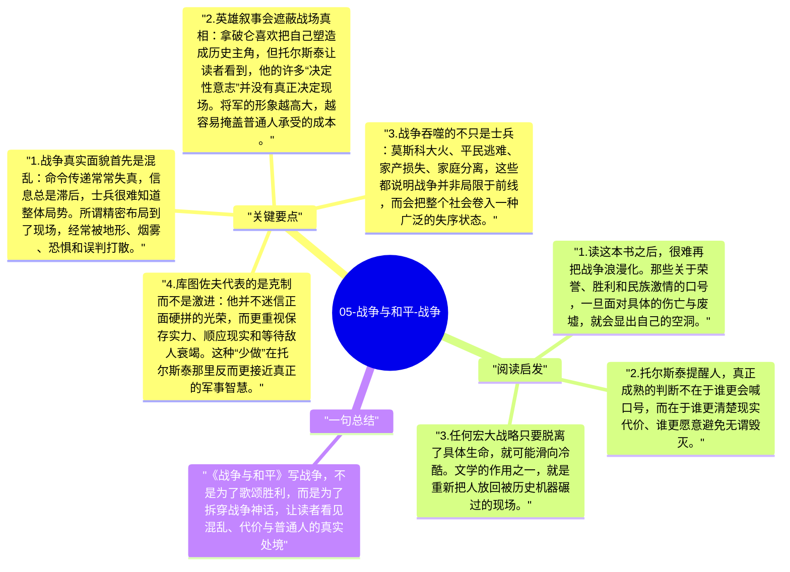

# 05-战争与和平-战争

《战争与和平》中的战争书写，最突出的特点是“去英雄化”。托尔斯泰不把战争写成荣耀舞台，也不把统帅写成全能导演；他反复展示的是战场的混乱、判断的失效、普通士兵的疲惫与死亡，以及所有宏大口号落到具体生命上时的残酷代价。

## 关键要点

1. **战争真实面貌首先是混乱**：命令传递常常失真，信息总是滞后，士兵很难知道整体局势。所谓精密布局到了现场，经常被地形、烟雾、恐惧和误判打散。
2. **英雄叙事会遮蔽战场真相**：拿破仑喜欢把自己塑造成历史主角，但托尔斯泰让读者看到，他的许多“决定性意志”并没有真正决定现场。将军的形象越高大，越容易掩盖普通人承受的成本。
3. **战争吞噬的不只是士兵**：莫斯科大火、平民逃难、家产损失、家庭分离，这些都说明战争并非局限于前线，而会把整个社会卷入一种广泛的失序状态。
4. **库图佐夫代表的是克制而不是激进**：他并不迷信正面硬拼的光荣，而更重视保存实力、顺应现实和等待敌人衰竭。这种“少做”在托尔斯泰那里反而更接近真正的军事智慧。
5. **战争最终暴露的是人的脆弱与制度的冷酷**：在宏大国家叙事中，个体常常只被当作数字或“牺牲”。托尔斯泰坚持把镜头对准那些普通人，从而恢复战争的伦理重量。

## 阅读启发

1. 读这本书之后，很难再把战争浪漫化。那些关于荣誉、胜利和民族激情的口号，一旦面对具体的伤亡与废墟，就会显出自己的空洞。
2. 托尔斯泰提醒人，真正成熟的判断不在于谁更会喊口号，而在于谁更清楚现实代价、谁更愿意避免无谓毁灭。
3. 任何宏大战略只要脱离了具体生命，就可能滑向冷酷。文学的作用之一，就是重新把人放回被历史机器碾过的现场。

## 一句总结

《战争与和平》写战争，不是为了歌颂胜利，而是为了拆穿战争神话，让读者看见混乱、代价与普通人的真实处境。

---

## Mermaid 思维导图

### 图1

