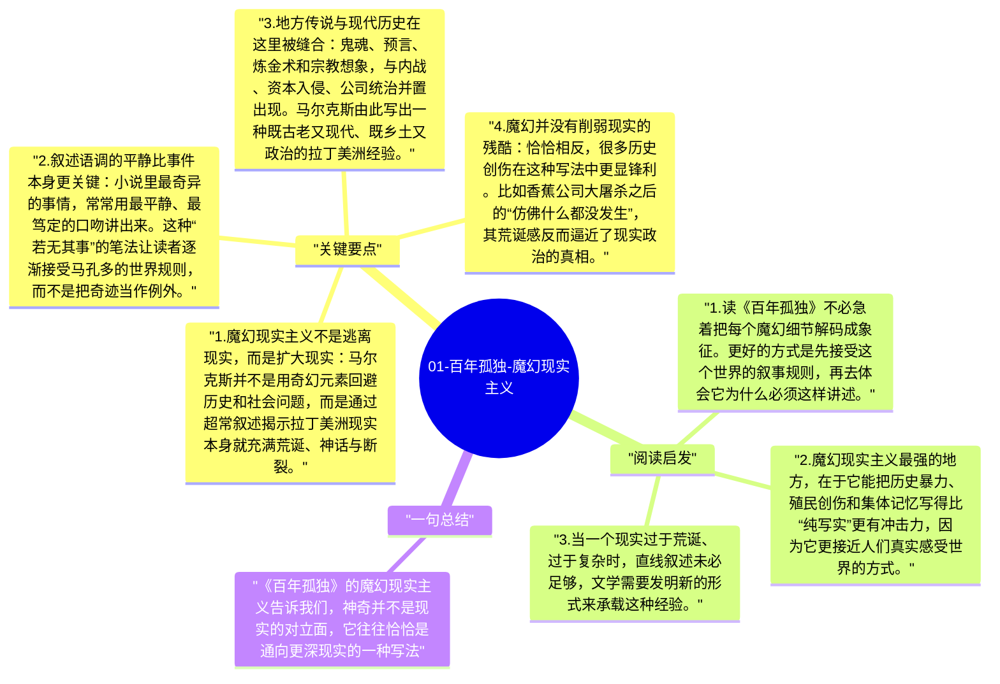

# 01-百年孤独-魔幻现实主义

《百年孤独》最先震撼读者的，往往不是情节本身，而是它讲述这些情节的方式。马尔克斯把飞升、预言、失眠瘟疫、鬼魂回返这些超现实事件，与日常做饭、做生意、恋爱、战争放在同一语调里叙述，由此创造出一种独特的阅读经验：神奇并不脱离现实，反而成为现实的一部分。

## 关键要点

1. **魔幻现实主义不是逃离现实，而是扩大现实**：马尔克斯并不是用奇幻元素回避历史和社会问题，而是通过超常叙述揭示拉丁美洲现实本身就充满荒诞、神话与断裂。
2. **叙述语调的平静比事件本身更关键**：小说里最奇异的事情，常常用最平静、最笃定的口吻讲出来。这种“若无其事”的笔法让读者逐渐接受马孔多的世界规则，而不是把奇迹当作例外。
3. **地方传说与现代历史在这里被缝合**：鬼魂、预言、炼金术和宗教想象，与内战、资本入侵、公司统治并置出现。马尔克斯由此写出一种既古老又现代、既乡土又政治的拉丁美洲经验。
4. **魔幻并没有削弱现实的残酷**：恰恰相反，很多历史创伤在这种写法中更显锋利。比如香蕉公司大屠杀之后的“仿佛什么都没发生”，其荒诞感反而逼近了现实政治的真相。
5. **它改变了读者理解“真实”的方式**：西方现实主义常要求事件可信、逻辑连贯，而《百年孤独》提醒人，某些民族和地区的现实经验，本身就不是单一理性框架能够容纳的。

## 阅读启发

1. 读《百年孤独》不必急着把每个魔幻细节解码成象征。更好的方式是先接受这个世界的叙事规则，再去体会它为什么必须这样讲述。
2. 魔幻现实主义最强的地方，在于它能把历史暴力、殖民创伤和集体记忆写得比“纯写实”更有冲击力，因为它更接近人们真实感受世界的方式。
3. 当一个现实过于荒诞、过于复杂时，直线叙述未必足够，文学需要发明新的形式来承载这种经验。

## 一句总结

《百年孤独》的魔幻现实主义告诉我们，神奇并不是现实的对立面，它往往恰恰是通向更深现实的一种写法。

---

## Mermaid 思维导图

### 图1

